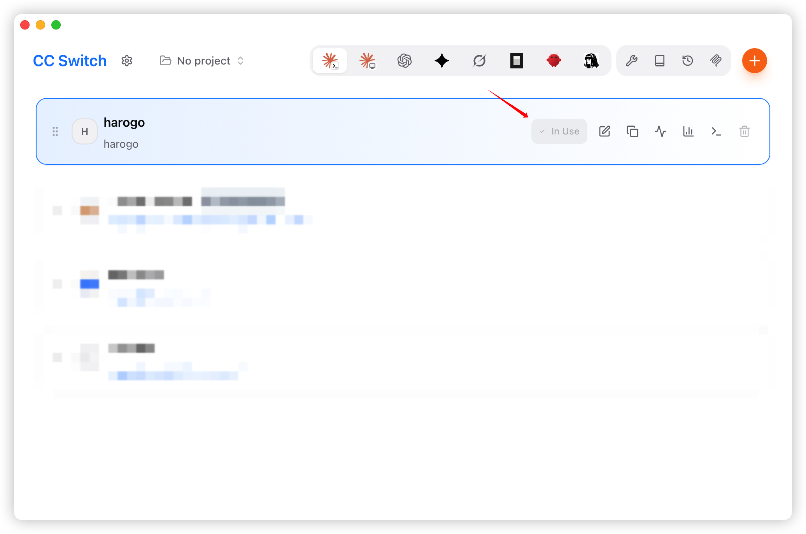

### 1. Install Claude Code

#### Local Installation

<CodeGroup>

```shellscript macOS
curl -fsSL https://claude.ai/install.sh | bash
```

```shellscript Windows
irm https://claude.ai/install.ps1 | iex
```

</CodeGroup>

#### Install via npm

Requires [Node.js 18 or later](https://nodejs.org/en/download/)

```shellscript
npm install -g @anthropic-ai/claude-code
```

### 2. Configure the Harogo API

To connect to Harogo's model service through the Anthropic-compatible API, set the following environment variables.

1. Set `ANTHROPIC_BASE_URL` to `https://api.harogo.ai/`
2. Set `ANTHROPIC_AUTH_TOKEN` to the API key you got from the [Harogo platform](https://console.harogo.ai/keys)
3. Set `ANTHROPIC_MODEL` to a Claude model supported by Harogo, for example `claude-sonnet-5`.

<Tabs>
  <Tab title="macOS">
    1. Run the following command in your terminal to check your default shell.

    ```shellscript
    echo $SHELL
    ```

    2. Set the environment variables based on your shell type:

    <CodeGroup>

    ```shellscript Zsh
    # Replace <HAROGO_API_KEY> with the real key from your Harogo platform
    echo 'export ANTHROPIC_BASE_URL="https://api.harogo.ai"' >> ~/.zshrc
    echo 'export ANTHROPIC_AUTH_TOKEN="<HAROGO_API_KEY>"' >> ~/.zshrc
    echo 'export ANTHROPIC_MODEL="claude-sonnet-5"' >> ~/.zshrc
    ```

    ```shellscript Bash
    # Replace <HAROGO_API_KEY> with the real key from your Harogo platform
    echo 'export ANTHROPIC_BASE_URL="https://api.harogo.ai"' >> ~/.bash_profile
    echo 'export ANTHROPIC_AUTH_TOKEN="<HAROGO_API_KEY>"' >> ~/.bash_profile
    echo 'export ANTHROPIC_MODEL="claude-sonnet-5"' >> ~/.bash_profile
    ```

    </CodeGroup>

    3. Run the following command in your terminal to apply the environment variables.

    <CodeGroup>

    ```shellscript Zsh
    source ~/.zshrc
    ```

    ```shellscript Bash
    source ~/.bash_profile
    ```

    </CodeGroup>

    4. Open a new terminal and run the following commands to confirm the environment variables took effect.

    ```shellscript
    echo $ANTHROPIC_BASE_URL
    test -n "$ANTHROPIC_AUTH_TOKEN" && echo "ANTHROPIC_AUTH_TOKEN is set"
    echo $ANTHROPIC_MODEL
    ```
  </Tab>
  <Tab title="Windows">
    On Windows, you can set Harogo's base URL and [API key](https://console.harogo.ai/keys) as environment variables using either CMD or PowerShell.

    <Tabs>
      <Tab title="CMD">
        1. Run the following command in CMD to set the environment variables.

        ```shellscript
        REM Replace <HAROGO_API_KEY> with the real key from your Harogo platform
        setx ANTHROPIC_AUTH_TOKEN "<HAROGO_API_KEY>"
        setx ANTHROPIC_BASE_URL "https://api.harogo.ai"
        setx ANTHROPIC_MODEL "claude-sonnet-5"
        ```

        2. Open a new CMD window and run the following commands to confirm the environment variables took effect.

        ```shellscript
        if defined ANTHROPIC_AUTH_TOKEN echo ANTHROPIC_AUTH_TOKEN is set
        echo %ANTHROPIC_BASE_URL%
        echo %ANTHROPIC_MODEL%
        ```
      </Tab>
      <Tab title="PowerShell">
        1. Run the following command in PowerShell to set the environment variables.

        ```shellscript
        # Replace <HAROGO_API_KEY> with the real key from your Harogo platform
        [Environment]::SetEnvironmentVariable("ANTHROPIC_AUTH_TOKEN", "<HAROGO_API_KEY>", [EnvironmentVariableTarget]::User)
        [Environment]::SetEnvironmentVariable("ANTHROPIC_BASE_URL", "https://api.harogo.ai", [EnvironmentVariableTarget]::User)
        [Environment]::SetEnvironmentVariable("ANTHROPIC_MODEL", "claude-sonnet-5", [EnvironmentVariableTarget]::User)
        ```

        2. Open a new PowerShell window and run the following commands to confirm the environment variables took effect.

        ```shellscript
        if ($env:ANTHROPIC_AUTH_TOKEN) { "ANTHROPIC_AUTH_TOKEN is set" }
        echo $env:ANTHROPIC_BASE_URL
        echo $env:ANTHROPIC_MODEL
        ```
      </Tab>
    </Tabs>
  </Tab>
</Tabs>

<Note>
  If you're going to manage Claude Code through CC Switch, we recommend not also setting global `ANTHROPIC_AUTH_TOKEN`, `ANTHROPIC_BASE_URL`, or `ANTHROPIC_MODEL` values. System- or user-level environment variables can override the provider config CC Switch writes, so the UI shows the correct provider selected while Claude Code is still actually running on an old key or model.
</Note>

### 3. Verify the Configuration

After setting up environment variables or CC Switch, send one minimal request first to confirm the key, model, and Anthropic-compatible endpoint are all working, before starting a longer session.

<CodeGroup>

```bash macOS/Linux
curl https://api.harogo.ai/v1/messages \
  -H "content-type: application/json" \
  -H "anthropic-version: 2023-06-01" \
  -H "x-api-key: $ANTHROPIC_AUTH_TOKEN" \
  -d '{
    "model": "claude-sonnet-5",
    "max_tokens": 16,
    "messages": [{"role": "user", "content": "1+1, output only the answer"}]
  }'
```

```powershell Windows
curl.exe https://api.harogo.ai/v1/messages `
  -H "content-type: application/json" `
  -H "anthropic-version: 2023-06-01" `
  -H "x-api-key: $env:ANTHROPIC_AUTH_TOKEN" `
  -d "{\"model\":\"claude-sonnet-5\",\"max_tokens\":16,\"messages\":[{\"role\":\"user\",\"content\":\"1+1, output only the answer\"}]}"
```

</CodeGroup>

### 4. Start Using Claude Code

Once configured, go to your working directory and run the `claude` command in your terminal to get started.

```bash
$ cd /path/your-project
> claude
```

If you see `Not logged in · Please run /login` on startup, or you're dropped into the Anthropic login flow, it usually means Claude Code didn't pick up a working Harogo configuration, or first-time onboarding hasn't been completed. First confirm the minimal request from the previous step returns `2`, and check whether `ANTHROPIC_AUTH_TOKEN`, `ANTHROPIC_BASE_URL`, or `ANTHROPIC_MODEL` are being overridden by old global environment variables. Once you've confirmed the key works, if you're still sent to the login flow, you can skip first-time onboarding with the steps below:


1. Locate the `.claude.json` file in your home directory:
   - macOS / Linux: `~/.claude.json`
   - Windows: `C:\Users\%USERNAME%\.claude.json`
2. Set the `hasCompletedOnboarding` field to `true`

```json
{
  "hasCompletedOnboarding": true
}
```

3. Save the file, then run `claude` again in your terminal.

#### (Optional) More Ways to Configure the Model

Claude Code supports the following ways to configure the model, **listed from highest to lowest priority** — a higher-priority setting overrides a lower-priority one.

1. **During a conversation:** run the `/model <model-name>` command to switch models. Good for a one-off switch.

```text
/model claude-sonnet-5
```

2. **When starting Claude Code:** run `claude --model <model-name>` to specify a model. Good for a single session.

```text
claude --model claude-sonnet-5
```

3. **Set environment variables:** configure different tiers of models by task complexity, and Claude Code will automatically pick the right one for the task. Applies globally.

```shellscript
export ANTHROPIC_DEFAULT_OPUS_MODEL="claude-opus-5"
export ANTHROPIC_DEFAULT_SONNET_MODEL="claude-sonnet-5"
export ANTHROPIC_DEFAULT_HAIKU_MODEL="claude-haiku-4-5"
```

Where:

- `ANTHROPIC_DEFAULT_OPUS_MODEL`: for complex reasoning, architecture design, and other high-difficulty tasks.
- `ANTHROPIC_DEFAULT_SONNET_MODEL`: for writing code, implementing features, and other everyday tasks.
- `ANTHROPIC_DEFAULT_HAIKU_MODEL`: for syntax checks, file search, and other simple tasks.

4. **Set permanently in settings.json:** write the model configuration into Claude Code's user config file (e.g. `~/.claude/settings.json`, or `C:\Users\%USERNAME%\.claude\settings.json` on Windows) or into a project-level config, for a permanent user-level or project-level setting.

## Configuring via CC Switch

1. Launch CC Switch, select **Claude Code** on the left, then click "Add Provider."


2. From the preset list, choose "Custom Configuration" as the provider.


3. Fill in the provider name, API key, and endpoint ([https://api.harogo.ai](https://api.harogo.ai)), etc. Once everything is filled in, click "Add."


4. Back on the home screen, select "harogo" from the provider list and click "Use."




> <Frame>
>        alt="Checking model configuration with the status and models commands in the Claude Code terminal"
>     width="1142"
>     height="1068"
>     data-path="images/image-68.png"
>     lightAlt="Checking model configuration with the status and models commands in the Claude Code terminal"
>     darkAlt="Checking model configuration with the status and models commands in the Claude Code terminal"
>     src="/images/iShot_2026-08-07_17.03.17.png"
>     className="dark:hidden"
>   />
>        alt="Checking model configuration with the status and models commands in the Claude Code terminal"
>     width="1142"
>     height="1068"
>     data-path="images/image-68.png"
>     lightAlt="Checking model configuration with the status and models commands in the Claude Code terminal"
>     darkAlt="Checking model configuration with the status and models commands in the Claude Code terminal"
>     src="https://mintcdn.com/aihubmix/mDZumr5HeEPTKpFC/images/image-68.png?fit=max&auto=format&n=mDZumr5HeEPTKpFC&q=85&s=a6dd56f69a939f0a6b174cefc371cee7"
>     className="hidden dark:block"
>   />
> </Frame>
>
> <Frame>
>   
> </Frame>
>
> Tip: once Claude Code is open in your terminal, type <kbd>/status</kbd> to check the model ID, or <kbd>/models</kbd> to pick another configured model.

<Warning>
  If CC Switch shows "System environment variable conflict detected," deal with `ANTHROPIC_AUTH_TOKEN`, `ANTHROPIC_BASE_URL`, and `ANTHROPIC_MODEL` first. These global variables override the current provider config — a placeholder value like `ANTHROPIC_AUTH_TOKEN=AIHUBMIX_API_KEY` will cause authentication to fail outright. Once you're sure you no longer need the global variables, remove the conflicting entries in CC Switch, or manually delete the system/user environment variables and restart your terminal.
</Warning>
