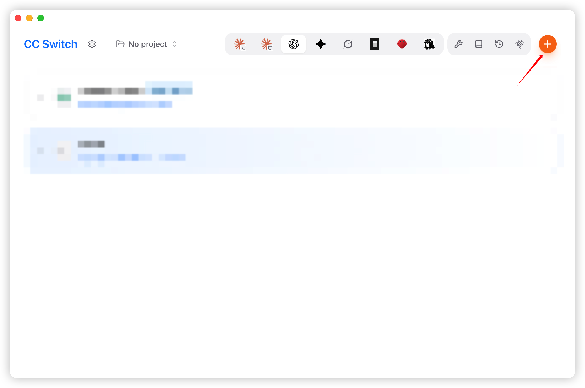

<Note>
**This guide uses GPT models only.** Codex can run the GPT models (GPT-6 Luna, GPT-6.2 Sol, GPT-6.2 Astra, GPT-6.1 Terra) plus the models with no client restriction (GLM, Qwen, Kimi, MiniMax, DeepSeek). Claude models are not available in Codex — see [Claude Code](/claude-code).
</Note>

## Installation

### Download from the official site (macOS)

[https://openai.com/codex/](https://openai.com/codex/)

### Install via the command line

```bash
npm install -g @openai/codex
```

## Environment Variable Configuration

### Configure via the config file

1. Edit your `~/.codex/config.toml` file and add the following:

```toml
profile = "harogo"

[model_providers.harogo]
name = "harogo"
base_url = "https://api.harogo.ai/v1"
personality = "pragmatic"
wire_api = "responses"

[profiles.harogo]
model = "gpt-6.2-sol"
model_provider = "harogo"
model_reasoning_effort = "high"
```

2. Edit your `~/.codex/auth.json` file and update it as follows:

```json
{
  "OPENAI_API_KEY": "HAROGO_API_KEY"
}
```

### Configure via cc-switch

1. Launch CC-Switch and add a provider.



2. From the preset list, choose "Custom Configuration."


3. Fill in the provider name, API key, and endpoint ([https://api.harogo.ai/v1](https://api.harogo.ai/v1)), etc. Once everything is filled in, click "Add."


4. Back on the home screen, select "harogo" and click "Enable" to start using it.


## Using Codex

### In the terminal

1. Open a terminal, navigate to your project directory, then run the `codex` command.

```bash
cd /path/to/your/project
codex
```

2. Set permissions as needed.


3. Type a natural-language prompt — if you get a normal response back, the setup was successful.
