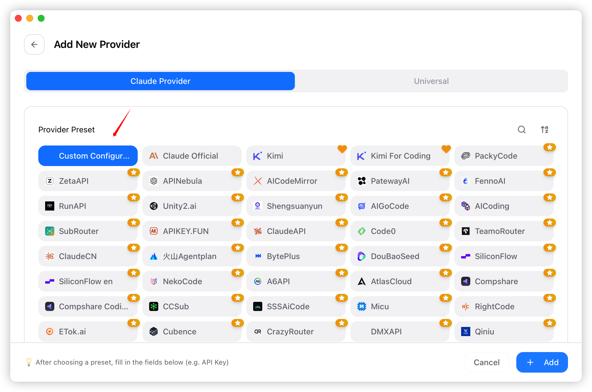

### 1. Claude Code installieren

#### Lokale Installation

<CodeGroup>

```shellscript macOS
curl -fsSL https://claude.ai/install.sh | bash
```

```shellscript Windows
irm https://claude.ai/install.ps1 | iex
```

</CodeGroup>

#### Installation über npm

Erfordert [Node.js 18 oder neuer](https://nodejs.org/en/download/)

```shellscript
npm install -g @anthropic-ai/claude-code
```

### 2. Harogo-API konfigurieren

Um sich über die Anthropic-kompatible API mit dem Modelldienst von Harogo zu verbinden, setzen Sie die folgenden Umgebungsvariablen.

1. Setzen Sie `ANTHROPIC_BASE_URL` auf `https://api.harogo.ai/`
2. Setzen Sie `ANTHROPIC_AUTH_TOKEN` auf den API-Key, den Sie auf der [Harogo-Plattform](https://console.harogo.ai/keys) erhalten haben
3. Setzen Sie `ANTHROPIC_MODEL` auf ein von Harogo unterstütztes Claude-Modell, zum Beispiel `claude-sonnet-5`.

<Tabs>
  <Tab title="macOS">
    1. Führen Sie im Terminal den folgenden Befehl aus, um Ihre Standard-Shell zu ermitteln.

    ```shellscript
    echo $SHELL
    ```

    2. Setzen Sie die Umgebungsvariablen passend zu Ihrer Shell:

    <CodeGroup>

    ```shellscript Zsh
    # Ersetzen Sie <HAROGO_API_KEY> durch den echten Key von Ihrer Harogo-Plattform
    echo 'export ANTHROPIC_BASE_URL="https://api.harogo.ai"' >> ~/.zshrc
    echo 'export ANTHROPIC_AUTH_TOKEN="<HAROGO_API_KEY>"' >> ~/.zshrc
    echo 'export ANTHROPIC_MODEL="claude-sonnet-5"' >> ~/.zshrc
    ```

    ```shellscript Bash
    # Ersetzen Sie <HAROGO_API_KEY> durch den echten Key von Ihrer Harogo-Plattform
    echo 'export ANTHROPIC_BASE_URL="https://api.harogo.ai"' >> ~/.bash_profile
    echo 'export ANTHROPIC_AUTH_TOKEN="<HAROGO_API_KEY>"' >> ~/.bash_profile
    echo 'export ANTHROPIC_MODEL="claude-sonnet-5"' >> ~/.bash_profile
    ```

    </CodeGroup>

    3. Führen Sie im Terminal den folgenden Befehl aus, damit die Umgebungsvariablen wirksam werden.

    <CodeGroup>

    ```shellscript Zsh
    source ~/.zshrc
    ```

    ```shellscript Bash
    source ~/.bash_profile
    ```

    </CodeGroup>

    4. Öffnen Sie ein neues Terminal und führen Sie die folgenden Befehle aus, um zu prüfen, ob die Umgebungsvariablen wirksam sind.

    ```shellscript
    echo $ANTHROPIC_BASE_URL
    test -n "$ANTHROPIC_AUTH_TOKEN" && echo "ANTHROPIC_AUTH_TOKEN is set"
    echo $ANTHROPIC_MODEL
    ```
  </Tab>
  <Tab title="Windows">
    Unter Windows können Sie die Base-URL und den [API-Key](https://console.harogo.ai/keys) von Harogo per CMD oder PowerShell als Umgebungsvariablen setzen.

    <Tabs>
      <Tab title="CMD">
        1. Führen Sie in CMD den folgenden Befehl aus, um die Umgebungsvariablen zu setzen.

        ```shellscript
        REM Ersetzen Sie <HAROGO_API_KEY> durch den echten Key von Ihrer Harogo-Plattform
        setx ANTHROPIC_AUTH_TOKEN "<HAROGO_API_KEY>"
        setx ANTHROPIC_BASE_URL "https://api.harogo.ai"
        setx ANTHROPIC_MODEL "claude-sonnet-5"
        ```

        2. Öffnen Sie ein neues CMD-Fenster und führen Sie die folgenden Befehle aus, um zu prüfen, ob die Umgebungsvariablen wirksam sind.

        ```shellscript
        if defined ANTHROPIC_AUTH_TOKEN echo ANTHROPIC_AUTH_TOKEN is set
        echo %ANTHROPIC_BASE_URL%
        echo %ANTHROPIC_MODEL%
        ```
      </Tab>
      <Tab title="PowerShell">
        1. Führen Sie in PowerShell den folgenden Befehl aus, um die Umgebungsvariablen zu setzen.

        ```shellscript
        # Ersetzen Sie <HAROGO_API_KEY> durch den echten Key von Ihrer Harogo-Plattform
        [Environment]::SetEnvironmentVariable("ANTHROPIC_AUTH_TOKEN", "<HAROGO_API_KEY>", [EnvironmentVariableTarget]::User)
        [Environment]::SetEnvironmentVariable("ANTHROPIC_BASE_URL", "https://api.harogo.ai", [EnvironmentVariableTarget]::User)
        [Environment]::SetEnvironmentVariable("ANTHROPIC_MODEL", "claude-sonnet-5", [EnvironmentVariableTarget]::User)
        ```

        2. Öffnen Sie ein neues PowerShell-Fenster und führen Sie die folgenden Befehle aus, um zu prüfen, ob die Umgebungsvariablen wirksam sind.

        ```shellscript
        if ($env:ANTHROPIC_AUTH_TOKEN) { "ANTHROPIC_AUTH_TOKEN is set" }
        echo $env:ANTHROPIC_BASE_URL
        echo $env:ANTHROPIC_MODEL
        ```
      </Tab>
    </Tabs>
  </Tab>
</Tabs>

<Note>
  Wenn Sie Claude Code über CC Switch verwalten möchten, empfehlen wir, nicht zusätzlich globale Werte für `ANTHROPIC_AUTH_TOKEN`, `ANTHROPIC_BASE_URL` oder `ANTHROPIC_MODEL` zu setzen. Umgebungsvariablen auf System- oder Benutzerebene können die von CC Switch geschriebene Anbieterkonfiguration überschreiben. Dann zeigt die Oberfläche zwar den richtigen Anbieter als ausgewählt an, Claude Code läuft aber tatsächlich noch mit einem alten Key oder Modell.
</Note>

### 3. Konfiguration prüfen

Senden Sie nach dem Einrichten der Umgebungsvariablen oder von CC Switch zuerst eine minimale Anfrage, um zu bestätigen, dass Key, Modell und Anthropic-kompatibler Endpoint funktionieren, bevor Sie eine längere Sitzung starten.

<CodeGroup>

```bash macOS/Linux
curl https://api.harogo.ai/v1/messages \
  -H "content-type: application/json" \
  -H "anthropic-version: 2023-06-01" \
  -H "x-api-key: $ANTHROPIC_AUTH_TOKEN" \
  -d '{
    "model": "claude-sonnet-5",
    "max_tokens": 16,
    "messages": [{"role": "user", "content": "1+1, output only the answer"}]
  }'
```

```powershell Windows
curl.exe https://api.harogo.ai/v1/messages `
  -H "content-type: application/json" `
  -H "anthropic-version: 2023-06-01" `
  -H "x-api-key: $env:ANTHROPIC_AUTH_TOKEN" `
  -d "{\"model\":\"claude-sonnet-5\",\"max_tokens\":16,\"messages\":[{\"role\":\"user\",\"content\":\"1+1, output only the answer\"}]}"
```

</CodeGroup>

### 4. Claude Code verwenden

Wechseln Sie nach der Konfiguration in Ihr Arbeitsverzeichnis und führen Sie im Terminal den Befehl `claude` aus.

```bash
$ cd /path/your-project
> claude
```

Wenn beim Start `Not logged in · Please run /login` erscheint oder Sie im Anthropic-Login landen, hat Claude Code in der Regel keine funktionierende Harogo-Konfiguration übernommen, oder das Onboarding beim ersten Start wurde noch nicht abgeschlossen. Prüfen Sie zuerst, ob die minimale Anfrage aus dem vorherigen Schritt `2` zurückgibt, und ob `ANTHROPIC_AUTH_TOKEN`, `ANTHROPIC_BASE_URL` oder `ANTHROPIC_MODEL` durch alte globale Umgebungsvariablen überschrieben werden. Wenn der Key nachweislich funktioniert und Sie trotzdem zum Login weitergeleitet werden, können Sie das Onboarding mit den folgenden Schritten überspringen:


1. Suchen Sie die Datei `.claude.json` in Ihrem Home-Verzeichnis:
   - macOS / Linux: `~/.claude.json`
   - Windows: `C:\Users\%USERNAME%\.claude.json`
2. Setzen Sie das Feld `hasCompletedOnboarding` auf `true`

```json
{
  "hasCompletedOnboarding": true
}
```

3. Speichern Sie die Datei und führen Sie `claude` im Terminal erneut aus.

#### (Optional) Weitere Möglichkeiten zur Modellkonfiguration

Claude Code unterstützt die folgenden Wege, das Modell zu konfigurieren, **absteigend nach Priorität sortiert**. Eine Einstellung mit höherer Priorität überschreibt eine mit niedrigerer.

1. **Während einer Unterhaltung:** Wechseln Sie das Modell mit dem Befehl `/model <model-name>`. Geeignet für einen einmaligen Wechsel.

```text
/model claude-sonnet-5
```

2. **Beim Start von Claude Code:** Geben Sie mit `claude --model <model-name>` ein Modell an. Geeignet für eine einzelne Sitzung.

```text
claude --model claude-sonnet-5
```

3. **Umgebungsvariablen setzen:** Konfigurieren Sie Modelle in verschiedenen Stufen je nach Aufgabenkomplexität. Claude Code wählt dann automatisch das passende Modell für die Aufgabe. Gilt global.

```shellscript
export ANTHROPIC_DEFAULT_OPUS_MODEL="claude-opus-5-5"
export ANTHROPIC_DEFAULT_SONNET_MODEL="claude-sonnet-5"
export ANTHROPIC_DEFAULT_HAIKU_MODEL="claude-haiku-5-5"
```

Dabei gilt:

- `ANTHROPIC_DEFAULT_OPUS_MODEL`: für komplexes Reasoning, Architekturentwurf und andere anspruchsvolle Aufgaben.
- `ANTHROPIC_DEFAULT_SONNET_MODEL`: für das Schreiben von Code, die Umsetzung von Features und andere alltägliche Aufgaben.
- `ANTHROPIC_DEFAULT_HAIKU_MODEL`: für Syntaxprüfungen, Dateisuche und andere einfache Aufgaben.

4. **Dauerhaft in settings.json festlegen:** Schreiben Sie die Modellkonfiguration in die Benutzerkonfigurationsdatei von Claude Code (z. B. `~/.claude/settings.json` bzw. unter Windows `C:\Users\%USERNAME%\.claude\settings.json`) oder in eine Projektkonfiguration, um sie dauerhaft auf Benutzer- oder Projektebene festzulegen.

## Konfiguration über CC Switch

1. Starten Sie CC Switch, wählen Sie links **Claude Code** aus und klicken Sie auf „Anbieter hinzufügen“ (Add Provider).


2. Wählen Sie in der Vorlagenliste „Benutzerdefinierte Konfiguration“ (Custom Configuration) als Anbieter aus.




3. Tragen Sie Anbietername, API-Key, Endpoint ([https://api.harogo.ai](https://api.harogo.ai)) usw. ein. Wenn alles ausgefüllt ist, klicken Sie auf „Hinzufügen“ (Add).


4. Wählen Sie auf dem Startbildschirm in der Anbieterliste „harogo“ aus und klicken Sie auf „Verwenden“ (Use).


> <Frame>
>        alt="Prüfen der Modellkonfiguration mit den Befehlen status und models im Claude-Code-Terminal"
>     width="1142"
>     height="1068"
>     data-path="images/image-68.png"
>     lightAlt="Prüfen der Modellkonfiguration mit den Befehlen status und models im Claude-Code-Terminal"
>     darkAlt="Prüfen der Modellkonfiguration mit den Befehlen status und models im Claude-Code-Terminal"
>     src="/images/iShot_2026-08-07_17.03.17.png"
>     className="dark:hidden"
>   />
>        alt="Prüfen der Modellkonfiguration mit den Befehlen status und models im Claude-Code-Terminal"
>     width="1142"
>     height="1068"
>     data-path="images/image-68.png"
>     lightAlt="Prüfen der Modellkonfiguration mit den Befehlen status und models im Claude-Code-Terminal"
>     darkAlt="Prüfen der Modellkonfiguration mit den Befehlen status und models im Claude-Code-Terminal"
>     src="https://mintcdn.com/aihubmix/mDZumr5HeEPTKpFC/images/image-68.png?fit=max&auto=format&n=mDZumr5HeEPTKpFC&q=85&s=a6dd56f69a939f0a6b174cefc371cee7"
>     className="hidden dark:block"
>   />
> </Frame>
>
> <Frame>
>   
> </Frame>
>
> Tipp: Wenn Claude Code im Terminal geöffnet ist, geben Sie <kbd>/status</kbd> ein, um die Modell-ID zu prüfen, oder <kbd>/models</kbd>, um ein anderes konfiguriertes Modell auszuwählen.

<Warning>
  Wenn CC Switch „Konflikt mit Systemumgebungsvariablen erkannt“ (System environment variable conflict detected) meldet, kümmern Sie sich zuerst um `ANTHROPIC_AUTH_TOKEN`, `ANTHROPIC_BASE_URL` und `ANTHROPIC_MODEL`. Diese globalen Variablen überschreiben die aktuelle Anbieterkonfiguration. Ein Platzhalterwert wie `ANTHROPIC_AUTH_TOKEN=<HAROGO_API_KEY>` führt direkt zu einem Authentifizierungsfehler. Wenn Sie sicher sind, dass Sie die globalen Variablen nicht mehr benötigen, entfernen Sie die konfliktverursachenden Einträge in CC Switch oder löschen Sie die System- bzw. Benutzerumgebungsvariablen manuell und starten Sie Ihr Terminal neu.
</Warning>
