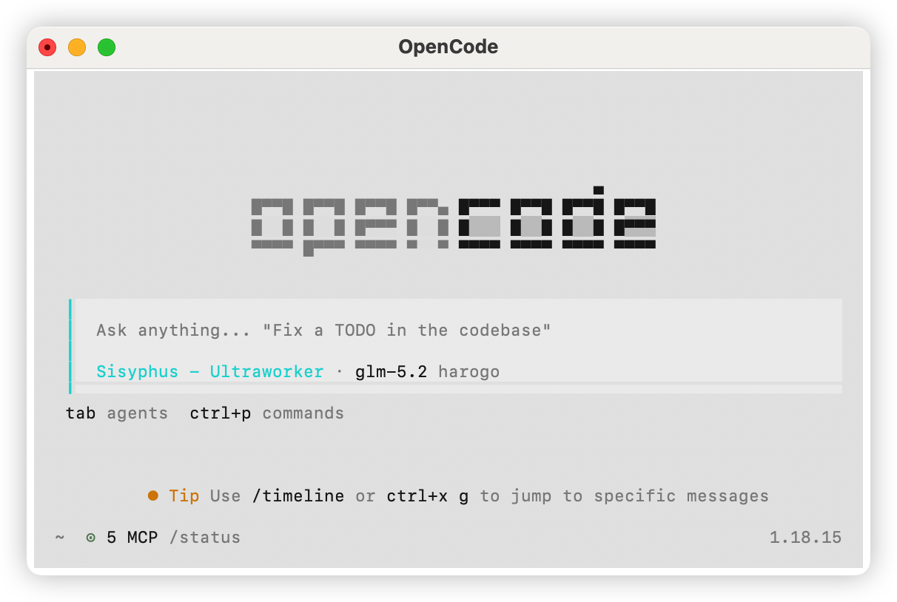

Antes de instalar, asegúrate de que tu sistema cumple los siguientes requisitos:

- **Node.js ≥ 18.0.0**
- Un gestor de paquetes para tu plataforma (opcional):
  - macOS / Linux: `brew`
  - Arch Linux: `paru`
  - Windows: `choco`, `winget` o `scoop`

## 1. Instalar OpenCode

Elige el método de instalación que mejor se adapte a tu sistema y tus herramientas.

### 1. Instalar con Node.js

```text
# Instalación rápida con el script de curl
curl -fsSL https://opencode.ai/install | bash

# Con NPM
npm install -g opencode-ai

# Con Bun
bun install -g opencode-ai

# Con PNPM
pnpm install -g opencode-ai

# Con Yarn
yarn global add opencode-ai
```

---

### 2. Con Homebrew (macOS / Linux)

```text
brew install sst/tap/opencode
```

---

### 3. Con Paru (Arch Linux)

```text
paru -S opencode-bin
```

---

### 4. Instalación en Windows

En Windows puedes instalar OpenCode con cualquiera de estas opciones:

```text
# Chocolatey
choco install opencode

# WinGet
winget install opencode

# Scoop
scoop bucket add extras
scoop install extras/opencode

# O con NPM (requiere Node.js); nota: requiere privilegios de administrador
npm install -g opencode-ai
```

---

## 2. Configurar OpenCode con CC Switch

1. Abre CC Switch, selecciona OpenCode a la izquierda y haz clic en "Añadir proveedor" (Add Provider).

<Frame>
  
</Frame>

2. En la lista de ajustes predefinidos, elige "Configuración personalizada" (Custom Configuration) como proveedor.

<Frame>
  
</Frame>

3. Completa la clave del proveedor, el nombre, la clave de API, el endpoint (`https://api.harogo.ai/v1`), etc.

<Frame>
  
  
</Frame>

4. Completa la información del modelo y guarda.

<Frame>
  
  
</Frame>

5. De vuelta en la pantalla de inicio, selecciona "harogo" en la lista de proveedores y haz clic en "Usar" (Use).

<Frame>
  
</Frame>

---

## 3. Usar el modelo

### 1. Verificar la instalación

Puedes comprobar que OpenCode se instaló y configuró correctamente con el siguiente comando:

```text
opencode
```



### 2. Seleccionar un modelo

Escribe `/models`, busca `harogo` y elige el modelo que quieras.


