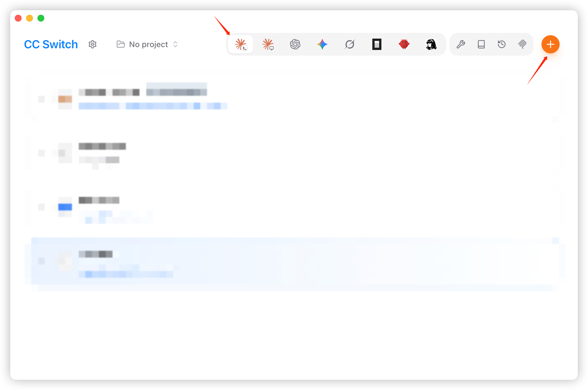

### 1. Installer Claude Code

#### Installation locale

<CodeGroup>

```shellscript macOS
curl -fsSL https://claude.ai/install.sh | bash
```

```shellscript Windows
irm https://claude.ai/install.ps1 | iex
```

</CodeGroup>

#### Installation via npm

Nécessite [Node.js 18 ou une version ultérieure](https://nodejs.org/en/download/)

```shellscript
npm install -g @anthropic-ai/claude-code
```

### 2. Configurer l'API Harogo

Pour vous connecter au service de modèles de Harogo via l'API compatible Anthropic, définissez les variables d'environnement suivantes.

1. Définissez `ANTHROPIC_BASE_URL` sur `https://api.harogo.ai/`
2. Définissez `ANTHROPIC_AUTH_TOKEN` sur la clé API obtenue sur la [plateforme Harogo](https://console.harogo.ai/keys)
3. Définissez `ANTHROPIC_MODEL` sur un modèle Claude pris en charge par Harogo, par exemple `claude-sonnet-5`.

<Tabs>
  <Tab title="macOS">
    1. Exécutez la commande suivante dans votre terminal pour vérifier votre shell par défaut.

    ```shellscript
    echo $SHELL
    ```

    2. Définissez les variables d'environnement selon votre type de shell :

    <CodeGroup>

    ```shellscript Zsh
    # Remplacez <HAROGO_API_KEY> par la vraie clé obtenue sur votre plateforme Harogo
    echo 'export ANTHROPIC_BASE_URL="https://api.harogo.ai"' >> ~/.zshrc
    echo 'export ANTHROPIC_AUTH_TOKEN="<HAROGO_API_KEY>"' >> ~/.zshrc
    echo 'export ANTHROPIC_MODEL="claude-sonnet-5"' >> ~/.zshrc
    ```

    ```shellscript Bash
    # Remplacez <HAROGO_API_KEY> par la vraie clé obtenue sur votre plateforme Harogo
    echo 'export ANTHROPIC_BASE_URL="https://api.harogo.ai"' >> ~/.bash_profile
    echo 'export ANTHROPIC_AUTH_TOKEN="<HAROGO_API_KEY>"' >> ~/.bash_profile
    echo 'export ANTHROPIC_MODEL="claude-sonnet-5"' >> ~/.bash_profile
    ```

    </CodeGroup>

    3. Exécutez la commande suivante dans votre terminal pour appliquer les variables d'environnement.

    <CodeGroup>

    ```shellscript Zsh
    source ~/.zshrc
    ```

    ```shellscript Bash
    source ~/.bash_profile
    ```

    </CodeGroup>

    4. Ouvrez un nouveau terminal et exécutez les commandes suivantes pour vérifier que les variables d'environnement sont bien prises en compte.

    ```shellscript
    echo $ANTHROPIC_BASE_URL
    test -n "$ANTHROPIC_AUTH_TOKEN" && echo "ANTHROPIC_AUTH_TOKEN is set"
    echo $ANTHROPIC_MODEL
    ```
  </Tab>
  <Tab title="Windows">
    Sous Windows, vous pouvez définir l'URL de base et la [clé API](https://console.harogo.ai/keys) de Harogo comme variables d'environnement avec CMD ou PowerShell.

    <Tabs>
      <Tab title="CMD">
        1. Exécutez la commande suivante dans CMD pour définir les variables d'environnement.

        ```shellscript
        REM Remplacez <HAROGO_API_KEY> par la vraie clé obtenue sur votre plateforme Harogo
        setx ANTHROPIC_AUTH_TOKEN "<HAROGO_API_KEY>"
        setx ANTHROPIC_BASE_URL "https://api.harogo.ai"
        setx ANTHROPIC_MODEL "claude-sonnet-5"
        ```

        2. Ouvrez une nouvelle fenêtre CMD et exécutez les commandes suivantes pour vérifier que les variables d'environnement sont bien prises en compte.

        ```shellscript
        if defined ANTHROPIC_AUTH_TOKEN echo ANTHROPIC_AUTH_TOKEN is set
        echo %ANTHROPIC_BASE_URL%
        echo %ANTHROPIC_MODEL%
        ```
      </Tab>
      <Tab title="PowerShell">
        1. Exécutez la commande suivante dans PowerShell pour définir les variables d'environnement.

        ```shellscript
        # Remplacez <HAROGO_API_KEY> par la vraie clé obtenue sur votre plateforme Harogo
        [Environment]::SetEnvironmentVariable("ANTHROPIC_AUTH_TOKEN", "<HAROGO_API_KEY>", [EnvironmentVariableTarget]::User)
        [Environment]::SetEnvironmentVariable("ANTHROPIC_BASE_URL", "https://api.harogo.ai", [EnvironmentVariableTarget]::User)
        [Environment]::SetEnvironmentVariable("ANTHROPIC_MODEL", "claude-sonnet-5", [EnvironmentVariableTarget]::User)
        ```

        2. Ouvrez une nouvelle fenêtre PowerShell et exécutez les commandes suivantes pour vérifier que les variables d'environnement sont bien prises en compte.

        ```shellscript
        if ($env:ANTHROPIC_AUTH_TOKEN) { "ANTHROPIC_AUTH_TOKEN is set" }
        echo $env:ANTHROPIC_BASE_URL
        echo $env:ANTHROPIC_MODEL
        ```
      </Tab>
    </Tabs>
  </Tab>
</Tabs>

<Note>
  Si vous prévoyez de gérer Claude Code avec CC Switch, nous vous recommandons de ne pas définir en plus des valeurs globales pour `ANTHROPIC_AUTH_TOKEN`, `ANTHROPIC_BASE_URL` ou `ANTHROPIC_MODEL`. Les variables d'environnement système ou utilisateur peuvent écraser la configuration de fournisseur écrite par CC Switch : l'interface affiche alors le bon fournisseur sélectionné, alors que Claude Code utilise en réalité encore une ancienne clé ou un ancien modèle.
</Note>

### 3. Vérifier la configuration

Après avoir configuré les variables d'environnement ou CC Switch, envoyez d'abord une requête minimale pour vérifier que la clé, le modèle et l'endpoint compatible Anthropic fonctionnent, avant de lancer une session plus longue.

<CodeGroup>

```bash macOS/Linux
curl https://api.harogo.ai/v1/messages \
  -H "content-type: application/json" \
  -H "anthropic-version: 2023-06-01" \
  -H "x-api-key: $ANTHROPIC_AUTH_TOKEN" \
  -d '{
    "model": "claude-sonnet-5",
    "max_tokens": 16,
    "messages": [{"role": "user", "content": "1+1, output only the answer"}]
  }'
```

```powershell Windows
curl.exe https://api.harogo.ai/v1/messages `
  -H "content-type: application/json" `
  -H "anthropic-version: 2023-06-01" `
  -H "x-api-key: $env:ANTHROPIC_AUTH_TOKEN" `
  -d "{\"model\":\"claude-sonnet-5\",\"max_tokens\":16,\"messages\":[{\"role\":\"user\",\"content\":\"1+1, output only the answer\"}]}"
```

</CodeGroup>

### 4. Commencer à utiliser Claude Code

Une fois la configuration terminée, placez-vous dans votre répertoire de travail et exécutez la commande `claude` dans votre terminal pour commencer.

```bash
$ cd /path/your-project
> claude
```

Si `Not logged in · Please run /login` s'affiche au démarrage, ou si vous êtes redirigé vers le processus de connexion d'Anthropic, cela signifie généralement que Claude Code n'a pas trouvé de configuration Harogo fonctionnelle, ou que la configuration initiale n'a pas été terminée. Vérifiez d'abord que la requête minimale de l'étape précédente renvoie `2`, et que `ANTHROPIC_AUTH_TOKEN`, `ANTHROPIC_BASE_URL` ou `ANTHROPIC_MODEL` ne sont pas écrasées par d'anciennes variables d'environnement globales. Si la clé fonctionne et que vous êtes toujours redirigé vers la connexion, vous pouvez ignorer la configuration initiale en suivant les étapes ci-dessous :


1. Repérez le fichier `.claude.json` dans votre répertoire personnel :
   - macOS / Linux : `~/.claude.json`
   - Windows : `C:\Users\%USERNAME%\.claude.json`
2. Définissez le champ `hasCompletedOnboarding` sur `true`

```json
{
  "hasCompletedOnboarding": true
}
```

3. Enregistrez le fichier, puis exécutez à nouveau `claude` dans votre terminal.

#### (Facultatif) Autres façons de configurer le modèle

Claude Code permet de configurer le modèle des manières suivantes, **classées par priorité décroissante** : un réglage de priorité plus élevée remplace un réglage de priorité plus faible.

1. **Pendant une conversation :** exécutez la commande `/model <model-name>` pour changer de modèle. Pratique pour un changement ponctuel.

```text
/model claude-sonnet-5
```

2. **Au lancement de Claude Code :** exécutez `claude --model <model-name>` pour indiquer un modèle. Pratique pour une seule session.

```text
claude --model claude-sonnet-5
```

3. **Définir des variables d'environnement :** configurez différents niveaux de modèles selon la complexité des tâches, et Claude Code choisira automatiquement le modèle adapté. S'applique globalement.

```shellscript
export ANTHROPIC_DEFAULT_OPUS_MODEL="claude-opus-5-5"
export ANTHROPIC_DEFAULT_SONNET_MODEL="claude-sonnet-5"
export ANTHROPIC_DEFAULT_HAIKU_MODEL="claude-haiku-5-5"
```

Où :

- `ANTHROPIC_DEFAULT_OPUS_MODEL` : pour le raisonnement complexe, la conception d'architecture et les autres tâches difficiles.
- `ANTHROPIC_DEFAULT_SONNET_MODEL` : pour l'écriture de code, l'implémentation de fonctionnalités et les autres tâches courantes.
- `ANTHROPIC_DEFAULT_HAIKU_MODEL` : pour les vérifications de syntaxe, la recherche de fichiers et les autres tâches simples.

4. **Définir de façon permanente dans settings.json :** écrivez la configuration du modèle dans le fichier de configuration utilisateur de Claude Code (par ex. `~/.claude/settings.json`, ou `C:\Users\%USERNAME%\.claude\settings.json` sous Windows) ou dans une configuration au niveau du projet, pour un réglage permanent au niveau utilisateur ou projet.

## Configuration via CC Switch

1. Lancez CC Switch, sélectionnez **Claude Code** à gauche, puis cliquez sur « Ajouter un fournisseur » (Add Provider).




2. Dans la liste des préréglages, choisissez « Configuration personnalisée » (Custom Configuration) comme fournisseur.


3. Renseignez le nom du fournisseur, la clé API, l'endpoint ([https://api.harogo.ai](https://api.harogo.ai)), etc. Une fois tous les champs remplis, cliquez sur « Ajouter » (Add).


4. De retour sur l'écran d'accueil, sélectionnez « harogo » dans la liste des fournisseurs et cliquez sur « Utiliser » (Use).


> <Frame>
>        alt="Vérification de la configuration du modèle avec les commandes status et models dans le terminal Claude Code"
>     width="1142"
>     height="1068"
>     data-path="images/image-68.png"
>     lightAlt="Vérification de la configuration du modèle avec les commandes status et models dans le terminal Claude Code"
>     darkAlt="Vérification de la configuration du modèle avec les commandes status et models dans le terminal Claude Code"
>     src="/images/iShot_2026-08-07_17.03.17.png"
>     className="dark:hidden"
>   />
>        alt="Vérification de la configuration du modèle avec les commandes status et models dans le terminal Claude Code"
>     width="1142"
>     height="1068"
>     data-path="images/image-68.png"
>     lightAlt="Vérification de la configuration du modèle avec les commandes status et models dans le terminal Claude Code"
>     darkAlt="Vérification de la configuration du modèle avec les commandes status et models dans le terminal Claude Code"
>     src="https://mintcdn.com/aihubmix/mDZumr5HeEPTKpFC/images/image-68.png?fit=max&auto=format&n=mDZumr5HeEPTKpFC&q=85&s=a6dd56f69a939f0a6b174cefc371cee7"
>     className="hidden dark:block"
>   />
> </Frame>
>
> <Frame>
>   
> </Frame>
>
> Astuce : une fois Claude Code ouvert dans votre terminal, tapez <kbd>/status</kbd> pour vérifier l'ID du modèle, ou <kbd>/models</kbd> pour choisir un autre modèle configuré.

<Warning>
  Si CC Switch affiche « Conflit de variables d'environnement système détecté » (System environment variable conflict detected), traitez d'abord `ANTHROPIC_AUTH_TOKEN`, `ANTHROPIC_BASE_URL` et `ANTHROPIC_MODEL`. Ces variables globales écrasent la configuration du fournisseur actuel : une valeur fictive comme `ANTHROPIC_AUTH_TOKEN=<HAROGO_API_KEY>` fera directement échouer l'authentification. Une fois certain de ne plus avoir besoin des variables globales, supprimez les entrées en conflit dans CC Switch, ou supprimez manuellement les variables d'environnement système/utilisateur et redémarrez votre terminal.
</Warning>
