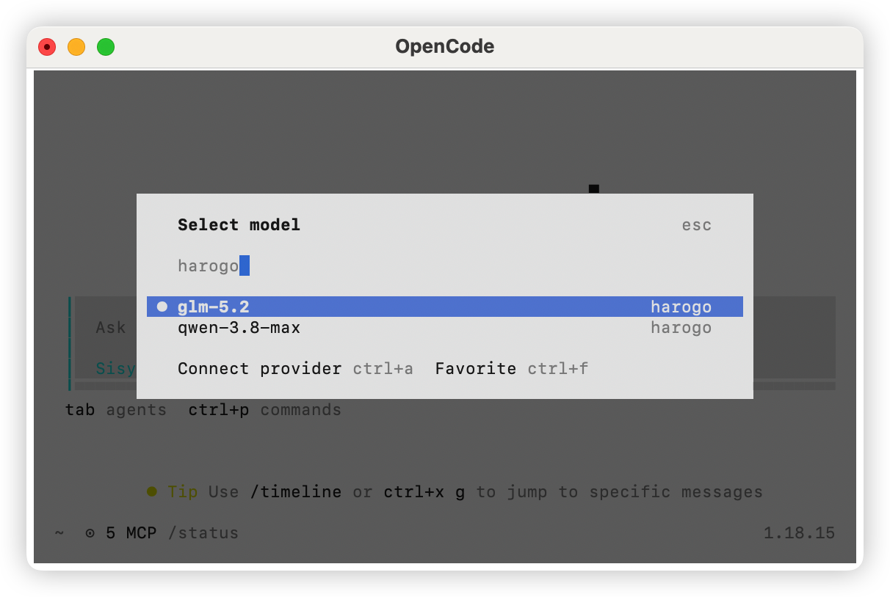

Avant l'installation, vérifiez que votre système remplit les conditions suivantes :

- **Node.js ≥ 18.0.0**
- Un gestionnaire de paquets pour votre plateforme (facultatif) :
  - macOS / Linux : `brew`
  - Arch Linux : `paru`
  - Windows : `choco`, `winget` ou `scoop`

## 1. Installer OpenCode

Choisissez la méthode d'installation qui convient à votre système et à vos outils.

### 1. Installer via Node.js

```text
# Installation rapide via le script curl
curl -fsSL https://opencode.ai/install | bash

# Avec NPM
npm install -g opencode-ai

# Avec Bun
bun install -g opencode-ai

# Avec PNPM
pnpm install -g opencode-ai

# Avec Yarn
yarn global add opencode-ai
```

---

### 2. Avec Homebrew (macOS / Linux)

```text
brew install sst/tap/opencode
```

---

### 3. Avec Paru (Arch Linux)

```text
paru -S opencode-bin
```

---

### 4. Installation sous Windows

Sous Windows, vous pouvez installer OpenCode de l'une des manières suivantes :

```text
# Chocolatey
choco install opencode

# WinGet
winget install opencode

# Scoop
scoop bucket add extras
scoop install extras/opencode

# Ou via NPM (nécessite Node.js) — remarque : nécessite des droits d'administrateur
npm install -g opencode-ai
```

---

## 2. Configurer OpenCode via CC Switch

1. Lancez CC Switch, sélectionnez OpenCode à gauche, puis cliquez sur « Ajouter un fournisseur » (Add Provider).

<Frame>
  
</Frame>

2. Dans la liste des préréglages, choisissez « Configuration personnalisée » (Custom Configuration) comme fournisseur.

<Frame>
  
</Frame>

3. Renseignez la clé du fournisseur, son nom, la clé API, l'endpoint (« https://api.harogo.ai/v1 »), etc.

<Frame>
  
  
</Frame>

4. Renseignez les informations du modèle, puis enregistrez.

<Frame>
  
  
</Frame>

5. De retour sur l'écran d'accueil, sélectionnez « harogo » dans la liste des fournisseurs et cliquez sur « Utiliser » (Use).

<Frame>
  
</Frame>

---

## 3. Utiliser le modèle

### 1. Vérifier l'installation

Vous pouvez vérifier qu'OpenCode est correctement installé et configuré avec la commande suivante :

```text
opencode
```


### 2. Choisir un modèle

Tapez `/models`, recherchez `harogo` et choisissez le modèle souhaité.



