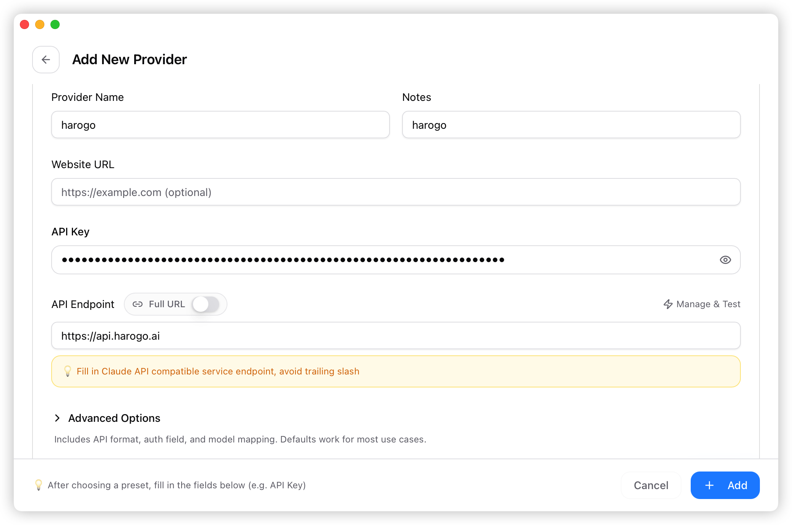

<Note>
**Questa guida usa solo modelli Claude.** Claude Code può eseguire i modelli Claude (Claude Opus 5.5, Claude Sonnet 5.5, Claude Sonnet 5, Claude Fable 5.1, Claude Haiku 5.5) e i modelli senza restrizioni di client (GLM, Qwen, Kimi, MiniMax, DeepSeek). I modelli GPT non sono disponibili in Claude Code — vedi [Codex](/it/codex).
</Note>

### 1. Installare Claude Code

#### Installazione locale

<CodeGroup>

```shellscript macOS
curl -fsSL https://claude.ai/install.sh | bash
```

```shellscript Windows
irm https://claude.ai/install.ps1 | iex
```

</CodeGroup>

#### Installazione tramite npm

Richiede [Node.js 18 o versioni successive](https://nodejs.org/en/download/)

```shellscript
npm install -g @anthropic-ai/claude-code
```

### 2. Configurare l'API Harogo

Per collegarti al servizio di modelli di Harogo tramite l'API compatibile con Anthropic, imposta le seguenti variabili d'ambiente.

1. Imposta `ANTHROPIC_BASE_URL` su `https://api.harogo.ai/`
2. Imposta `ANTHROPIC_AUTH_TOKEN` sulla chiave API ottenuta dalla [piattaforma Harogo](https://console.harogo.ai/keys)
3. Imposta `ANTHROPIC_MODEL` su un modello Claude supportato da Harogo, ad esempio `claude-sonnet-5`.

<Tabs>
  <Tab title="macOS">
    1. Esegui il seguente comando nel terminale per verificare la tua shell predefinita.

    ```shellscript
    echo $SHELL
    ```

    2. Imposta le variabili d'ambiente in base al tipo di shell:

    <CodeGroup>

    ```shellscript Zsh
    # Sostituisci <HAROGO_API_KEY> con la chiave reale ottenuta dalla tua piattaforma Harogo
    echo 'export ANTHROPIC_BASE_URL="https://api.harogo.ai"' >> ~/.zshrc
    echo 'export ANTHROPIC_AUTH_TOKEN="<HAROGO_API_KEY>"' >> ~/.zshrc
    echo 'export ANTHROPIC_MODEL="claude-sonnet-5"' >> ~/.zshrc
    ```

    ```shellscript Bash
    # Sostituisci <HAROGO_API_KEY> con la chiave reale ottenuta dalla tua piattaforma Harogo
    echo 'export ANTHROPIC_BASE_URL="https://api.harogo.ai"' >> ~/.bash_profile
    echo 'export ANTHROPIC_AUTH_TOKEN="<HAROGO_API_KEY>"' >> ~/.bash_profile
    echo 'export ANTHROPIC_MODEL="claude-sonnet-5"' >> ~/.bash_profile
    ```

    </CodeGroup>

    3. Esegui il seguente comando nel terminale per applicare le variabili d'ambiente.

    <CodeGroup>

    ```shellscript Zsh
    source ~/.zshrc
    ```

    ```shellscript Bash
    source ~/.bash_profile
    ```

    </CodeGroup>

    4. Apri un nuovo terminale ed esegui i seguenti comandi per verificare che le variabili d'ambiente siano attive.

    ```shellscript
    echo $ANTHROPIC_BASE_URL
    test -n "$ANTHROPIC_AUTH_TOKEN" && echo "ANTHROPIC_AUTH_TOKEN is set"
    echo $ANTHROPIC_MODEL
    ```
  </Tab>
  <Tab title="Windows">
    Su Windows puoi impostare il Base URL e la [chiave API](https://console.harogo.ai/keys) di Harogo come variabili d'ambiente tramite CMD o PowerShell.

    <Tabs>
      <Tab title="CMD">
        1. Esegui il seguente comando in CMD per impostare le variabili d'ambiente.

        ```shellscript
        REM Sostituisci <HAROGO_API_KEY> con la chiave reale ottenuta dalla tua piattaforma Harogo
        setx ANTHROPIC_AUTH_TOKEN "<HAROGO_API_KEY>"
        setx ANTHROPIC_BASE_URL "https://api.harogo.ai"
        setx ANTHROPIC_MODEL "claude-sonnet-5"
        ```

        2. Apri una nuova finestra di CMD ed esegui i seguenti comandi per verificare che le variabili d'ambiente siano attive.

        ```shellscript
        if defined ANTHROPIC_AUTH_TOKEN echo ANTHROPIC_AUTH_TOKEN is set
        echo %ANTHROPIC_BASE_URL%
        echo %ANTHROPIC_MODEL%
        ```
      </Tab>
      <Tab title="PowerShell">
        1. Esegui il seguente comando in PowerShell per impostare le variabili d'ambiente.

        ```shellscript
        # Sostituisci <HAROGO_API_KEY> con la chiave reale ottenuta dalla tua piattaforma Harogo
        [Environment]::SetEnvironmentVariable("ANTHROPIC_AUTH_TOKEN", "<HAROGO_API_KEY>", [EnvironmentVariableTarget]::User)
        [Environment]::SetEnvironmentVariable("ANTHROPIC_BASE_URL", "https://api.harogo.ai", [EnvironmentVariableTarget]::User)
        [Environment]::SetEnvironmentVariable("ANTHROPIC_MODEL", "claude-sonnet-5", [EnvironmentVariableTarget]::User)
        ```

        2. Apri una nuova finestra di PowerShell ed esegui i seguenti comandi per verificare che le variabili d'ambiente siano attive.

        ```shellscript
        if ($env:ANTHROPIC_AUTH_TOKEN) { "ANTHROPIC_AUTH_TOKEN is set" }
        echo $env:ANTHROPIC_BASE_URL
        echo $env:ANTHROPIC_MODEL
        ```
      </Tab>
    </Tabs>
  </Tab>
</Tabs>

<Note>
  Se intendi gestire Claude Code tramite CC Switch, ti consigliamo di non impostare anche valori globali per `ANTHROPIC_AUTH_TOKEN`, `ANTHROPIC_BASE_URL` o `ANTHROPIC_MODEL`. Le variabili d'ambiente di sistema o utente possono sovrascrivere la configurazione del provider scritta da CC Switch: l'interfaccia mostra selezionato il provider corretto, ma Claude Code in realtà continua a usare una vecchia chiave o un vecchio modello.
</Note>

### 3. Verificare la configurazione

Dopo aver configurato le variabili d'ambiente o CC Switch, invia prima una richiesta minima per verificare che chiave, modello ed endpoint compatibile con Anthropic funzionino, prima di avviare una sessione più lunga.

<CodeGroup>

```bash macOS/Linux
curl https://api.harogo.ai/v1/messages \
  -H "content-type: application/json" \
  -H "anthropic-version: 2023-06-01" \
  -H "x-api-key: $ANTHROPIC_AUTH_TOKEN" \
  -d '{
    "model": "claude-sonnet-5",
    "max_tokens": 16,
    "messages": [{"role": "user", "content": "1+1, output only the answer"}]
  }'
```

```powershell Windows
curl.exe https://api.harogo.ai/v1/messages `
  -H "content-type: application/json" `
  -H "anthropic-version: 2023-06-01" `
  -H "x-api-key: $env:ANTHROPIC_AUTH_TOKEN" `
  -d "{\"model\":\"claude-sonnet-5\",\"max_tokens\":16,\"messages\":[{\"role\":\"user\",\"content\":\"1+1, output only the answer\"}]}"
```

</CodeGroup>

### 4. Iniziare a usare Claude Code

Una volta completata la configurazione, spostati nella tua directory di lavoro ed esegui il comando `claude` nel terminale per iniziare.

```bash
$ cd /path/your-project
> claude
```

Se all'avvio compare `Not logged in · Please run /login`, oppure vieni portato nel flusso di accesso di Anthropic, di solito significa che Claude Code non ha trovato una configurazione Harogo funzionante o che l'onboarding iniziale non è stato completato. Verifica prima che la richiesta minima del passaggio precedente restituisca `2` e controlla che `ANTHROPIC_AUTH_TOKEN`, `ANTHROPIC_BASE_URL` o `ANTHROPIC_MODEL` non vengano sovrascritte da vecchie variabili d'ambiente globali. Se la chiave funziona e vieni comunque portato al flusso di accesso, puoi saltare l'onboarding iniziale con i passaggi seguenti:


1. Individua il file `.claude.json` nella tua home directory:
   - macOS / Linux: `~/.claude.json`
   - Windows: `C:\Users\%USERNAME%\.claude.json`
2. Imposta il campo `hasCompletedOnboarding` su `true`

```json
{
  "hasCompletedOnboarding": true
}
```

3. Salva il file, poi esegui di nuovo `claude` nel terminale.

#### (Facoltativo) Altri modi per configurare il modello

Claude Code supporta i seguenti modi per configurare il modello, **elencati dalla priorità più alta alla più bassa**: un'impostazione con priorità più alta sovrascrive quella con priorità più bassa.

1. **Durante una conversazione:** esegui il comando `/model <model-name>` per cambiare modello. Utile per un cambio occasionale.

```text
/model claude-sonnet-5
```

2. **All'avvio di Claude Code:** esegui `claude --model <model-name>` per specificare un modello. Utile per una singola sessione.

```text
claude --model claude-sonnet-5
```

3. **Impostare le variabili d'ambiente:** configura diversi livelli di modello in base alla complessità del task e Claude Code sceglierà automaticamente quello adatto. Si applica a livello globale.

```shellscript
export ANTHROPIC_DEFAULT_OPUS_MODEL="claude-opus-5-5"
export ANTHROPIC_DEFAULT_SONNET_MODEL="claude-sonnet-5"
export ANTHROPIC_DEFAULT_HAIKU_MODEL="claude-haiku-5-5"
```

Dove:

- `ANTHROPIC_DEFAULT_OPUS_MODEL`: per ragionamento complesso, progettazione dell'architettura e altri task difficili.
- `ANTHROPIC_DEFAULT_SONNET_MODEL`: per scrivere codice, implementare funzionalità e altri task quotidiani.
- `ANTHROPIC_DEFAULT_HAIKU_MODEL`: per controlli di sintassi, ricerca di file e altri task semplici.

4. **Impostazione permanente in settings.json:** scrivi la configurazione del modello nel file di configurazione utente di Claude Code (ad es. `~/.claude/settings.json`, oppure `C:\Users\%USERNAME%\.claude\settings.json` su Windows) o in una configurazione a livello di progetto, per un'impostazione permanente a livello utente o di progetto.

## Configurazione tramite CC Switch

1. Avvia CC Switch, seleziona **Claude Code** a sinistra, poi fai clic su "Aggiungi provider" (Add Provider).


2. Dall'elenco dei preset, scegli "Configurazione personalizzata" (Custom Configuration) come provider.


3. Inserisci il nome del provider, la chiave API, l'endpoint ([https://api.harogo.ai](https://api.harogo.ai)) e così via. Una volta compilati tutti i campi, fai clic su "Aggiungi" (Add).




4. Tornato alla schermata principale, seleziona "harogo" dall'elenco dei provider e fai clic su "Usa" (Use).


> <Frame>
>        alt="Verifica della configurazione del modello con i comandi status e models nel terminale di Claude Code"
>     width="1142"
>     height="1068"
>     data-path="images/image-68.png"
>     lightAlt="Verifica della configurazione del modello con i comandi status e models nel terminale di Claude Code"
>     darkAlt="Verifica della configurazione del modello con i comandi status e models nel terminale di Claude Code"
>     src="/images/iShot_2026-08-07_17.03.17.png"
>     className="dark:hidden"
>   />
>        alt="Verifica della configurazione del modello con i comandi status e models nel terminale di Claude Code"
>     width="1142"
>     height="1068"
>     data-path="images/image-68.png"
>     lightAlt="Verifica della configurazione del modello con i comandi status e models nel terminale di Claude Code"
>     darkAlt="Verifica della configurazione del modello con i comandi status e models nel terminale di Claude Code"
>     src="https://mintcdn.com/aihubmix/mDZumr5HeEPTKpFC/images/image-68.png?fit=max&auto=format&n=mDZumr5HeEPTKpFC&q=85&s=a6dd56f69a939f0a6b174cefc371cee7"
>     className="hidden dark:block"
>   />
> </Frame>
>
> <Frame>
>   
> </Frame>
>
> Suggerimento: una volta aperto Claude Code nel terminale, digita <kbd>/status</kbd> per verificare l'ID del modello, oppure <kbd>/models</kbd> per scegliere un altro modello configurato.

<Warning>
  Se CC Switch mostra "Rilevato conflitto con variabili d'ambiente di sistema" (System environment variable conflict detected), occupati prima di `ANTHROPIC_AUTH_TOKEN`, `ANTHROPIC_BASE_URL` e `ANTHROPIC_MODEL`. Queste variabili globali sovrascrivono la configurazione del provider attuale: un valore segnaposto come `ANTHROPIC_AUTH_TOKEN=<HAROGO_API_KEY>` farà fallire direttamente l'autenticazione. Quando sei sicuro di non aver più bisogno delle variabili globali, rimuovi le voci in conflitto in CC Switch, oppure elimina manualmente le variabili d'ambiente di sistema/utente e riavvia il terminale.
</Warning>
