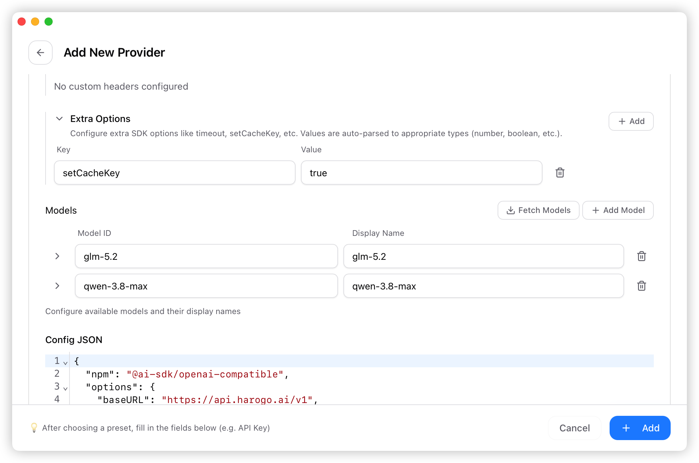

Prima dell'installazione, assicurati che il tuo sistema soddisfi i seguenti requisiti:

- **Node.js ≥ 18.0.0**
- Un gestore di pacchetti per la tua piattaforma (facoltativo):
  - macOS / Linux: `brew`
  - Arch Linux: `paru`
  - Windows: `choco`, `winget` o `scoop`

## 1. Installare OpenCode

Scegli il metodo di installazione più adatto al tuo sistema e ai tuoi strumenti.

### 1. Installazione tramite Node.js

```text
# Installazione rapida tramite script curl
curl -fsSL https://opencode.ai/install | bash

# Con NPM
npm install -g opencode-ai

# Con Bun
bun install -g opencode-ai

# Con PNPM
pnpm install -g opencode-ai

# Con Yarn
yarn global add opencode-ai
```

---

### 2. Con Homebrew (macOS / Linux)

```text
brew install sst/tap/opencode
```

---

### 3. Con Paru (Arch Linux)

```text
paru -S opencode-bin
```

---

### 4. Installazione su Windows

Su Windows puoi installare OpenCode in uno dei seguenti modi:

```text
# Chocolatey
choco install opencode

# WinGet
winget install opencode

# Scoop
scoop bucket add extras
scoop install extras/opencode

# Oppure tramite NPM (richiede Node.js) — nota: richiede privilegi di amministratore
npm install -g opencode-ai
```

---

## 2. Configurare OpenCode tramite CC Switch

1. Avvia CC Switch, seleziona OpenCode a sinistra, poi fai clic su "Aggiungi provider" (Add Provider).

<Frame>
  
</Frame>

2. Dall'elenco dei preset, scegli "Configurazione personalizzata" (Custom Configuration) come provider.

<Frame>
  
</Frame>

3. Inserisci la chiave del provider, il nome, la chiave API, l'endpoint (`https://api.harogo.ai/v1`) e così via.

<Frame>
  
  
</Frame>

4. Inserisci le informazioni del modello, poi salva.

<Frame>
  
  
</Frame>

5. Tornato alla schermata principale, seleziona "harogo" dall'elenco dei provider e fai clic su "Usa" (Use).

<Frame>
  
</Frame>

---

## 3. Usare il modello

### 1. Verificare l'installazione

Puoi verificare che OpenCode sia installato e configurato correttamente con il seguente comando:

```text
opencode
```


### 2. Selezionare un modello

Digita `/models`, cerca `harogo` e scegli il modello che preferisci.


