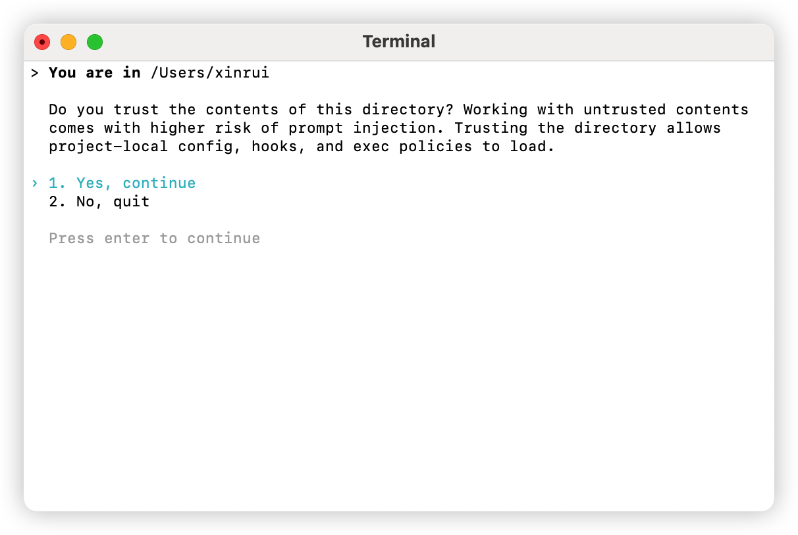

<Note>
**このガイドは GPT シリーズのみを対象としています。** Codex では GPT シリーズ（GPT-6 Luna、GPT-6.1 Sol、GPT-6 Astra、GPT-6.1 Terra）と、制限のないモデル（GLM、Qwen、Kimi、MiniMax、DeepSeek）を利用できます。Claude シリーズは Codex では利用できません。[Claude Code](/ja/claude-code) をご覧ください。
</Note>

## インストール

### 公式サイトからダウンロードする（macOS）

[https://openai.com/codex/](https://openai.com/codex/)

### コマンドラインでインストールする

```bash
npm install -g @openai/codex
```

## 環境変数の設定

### 設定ファイルで設定する

1. `~/.codex/config.toml`ファイルを編集し、次の内容を追加します。

```toml
profile = "harogo"

[model_providers.harogo]
name = "harogo"
base_url = "https://api.harogo.ai/v1"
personality = "pragmatic"
wire_api = "responses"

[profiles.harogo]
model = "gpt-6.1-sol"
model_provider = "harogo"
model_reasoning_effort = "high"
```

2. `~/.codex/auth.json`ファイルを編集し、次のように更新します。

```json
{
  "OPENAI_API_KEY": "HAROGO_API_KEY"
}
```

### cc-switchで設定する

1. CC-Switchを起動し、プロバイダーを追加します。


2. プリセット一覧から「カスタム設定」（Custom Configuration）を選択します。


3. プロバイダー名、APIキー、エンドポイント（[https://api.harogo.ai/v1](https://api.harogo.ai/v1)）などを入力します。すべて入力したら「追加」（Add）をクリックします。


4. ホーム画面に戻り、「harogo」を選択して「有効化」（Enable）をクリックすると利用を開始できます。


## Codexを使う

### ターミナルで使う

1. ターミナルを開いてプロジェクトディレクトリに移動し、`codex`コマンドを実行します。

```bash
cd /path/to/your/project
codex
```

2. 必要に応じて権限を設定します。



3. 自然言語でプロンプトを入力します。正常な応答が返ってくれば、セットアップは完了です。
