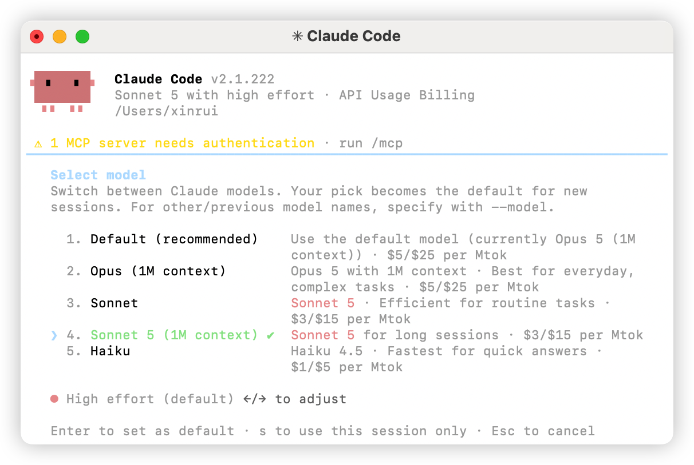

<Note>
**이 가이드는 Claude 시리즈만 사용합니다.** Claude Code에서는 Claude 시리즈(Claude Opus 5.5, Claude Sonnet 5.5, Claude Sonnet 5, Claude Fable 5.1, Claude Haiku 5.5)와 제한이 없는 모델(GLM, Qwen, Kimi, MiniMax, DeepSeek)을 실행할 수 있습니다. GPT 시리즈는 Claude Code에서 사용할 수 없습니다. [Codex](/ko/codex)를 참고하세요.
</Note>

### 1. Claude Code 설치

#### 로컬 설치

<CodeGroup>

```shellscript macOS
curl -fsSL https://claude.ai/install.sh | bash
```

```shellscript Windows
irm https://claude.ai/install.ps1 | iex
```

</CodeGroup>

#### npm으로 설치

[Node.js 18 이상](https://nodejs.org/en/download/)이 필요합니다

```shellscript
npm install -g @anthropic-ai/claude-code
```

### 2. Harogo API 설정

Anthropic 호환 API를 통해 Harogo의 모델 서비스에 연결하려면 다음 환경 변수를 설정하세요.

1. `ANTHROPIC_BASE_URL`을 `https://api.harogo.ai/`로 설정합니다
2. `ANTHROPIC_AUTH_TOKEN`을 [Harogo 플랫폼](https://console.harogo.ai/keys)에서 발급받은 API 키로 설정합니다
3. `ANTHROPIC_MODEL`을 Harogo에서 지원하는 Claude 모델(예: `claude-sonnet-5`)로 설정합니다.

<Tabs>
  <Tab title="macOS">
    1. 터미널에서 다음 명령을 실행해 기본 셸을 확인합니다.

    ```shellscript
    echo $SHELL
    ```

    2. 셸 종류에 따라 환경 변수를 설정합니다.

    <CodeGroup>

    ```shellscript Zsh
    # <HAROGO_API_KEY>를 Harogo 플랫폼에서 발급받은 실제 키로 바꾸세요
    echo 'export ANTHROPIC_BASE_URL="https://api.harogo.ai"' >> ~/.zshrc
    echo 'export ANTHROPIC_AUTH_TOKEN="<HAROGO_API_KEY>"' >> ~/.zshrc
    echo 'export ANTHROPIC_MODEL="claude-sonnet-5"' >> ~/.zshrc
    ```

    ```shellscript Bash
    # <HAROGO_API_KEY>를 Harogo 플랫폼에서 발급받은 실제 키로 바꾸세요
    echo 'export ANTHROPIC_BASE_URL="https://api.harogo.ai"' >> ~/.bash_profile
    echo 'export ANTHROPIC_AUTH_TOKEN="<HAROGO_API_KEY>"' >> ~/.bash_profile
    echo 'export ANTHROPIC_MODEL="claude-sonnet-5"' >> ~/.bash_profile
    ```

    </CodeGroup>

    3. 터미널에서 다음 명령을 실행해 환경 변수를 적용합니다.

    <CodeGroup>

    ```shellscript Zsh
    source ~/.zshrc
    ```

    ```shellscript Bash
    source ~/.bash_profile
    ```

    </CodeGroup>

    4. 새 터미널을 열고 다음 명령을 실행해 환경 변수가 적용되었는지 확인합니다.

    ```shellscript
    echo $ANTHROPIC_BASE_URL
    test -n "$ANTHROPIC_AUTH_TOKEN" && echo "ANTHROPIC_AUTH_TOKEN is set"
    echo $ANTHROPIC_MODEL
    ```
  </Tab>
  <Tab title="Windows">
    Windows에서는 CMD 또는 PowerShell을 사용해 Harogo의 Base URL과 [API 키](https://console.harogo.ai/keys)를 환경 변수로 설정할 수 있습니다.

    <Tabs>
      <Tab title="CMD">
        1. CMD에서 다음 명령을 실행해 환경 변수를 설정합니다.

        ```shellscript
        REM <HAROGO_API_KEY>를 Harogo 플랫폼에서 발급받은 실제 키로 바꾸세요
        setx ANTHROPIC_AUTH_TOKEN "<HAROGO_API_KEY>"
        setx ANTHROPIC_BASE_URL "https://api.harogo.ai"
        setx ANTHROPIC_MODEL "claude-sonnet-5"
        ```

        2. 새 CMD 창을 열고 다음 명령을 실행해 환경 변수가 적용되었는지 확인합니다.

        ```shellscript
        if defined ANTHROPIC_AUTH_TOKEN echo ANTHROPIC_AUTH_TOKEN is set
        echo %ANTHROPIC_BASE_URL%
        echo %ANTHROPIC_MODEL%
        ```
      </Tab>
      <Tab title="PowerShell">
        1. PowerShell에서 다음 명령을 실행해 환경 변수를 설정합니다.

        ```shellscript
        # <HAROGO_API_KEY>를 Harogo 플랫폼에서 발급받은 실제 키로 바꾸세요
        [Environment]::SetEnvironmentVariable("ANTHROPIC_AUTH_TOKEN", "<HAROGO_API_KEY>", [EnvironmentVariableTarget]::User)
        [Environment]::SetEnvironmentVariable("ANTHROPIC_BASE_URL", "https://api.harogo.ai", [EnvironmentVariableTarget]::User)
        [Environment]::SetEnvironmentVariable("ANTHROPIC_MODEL", "claude-sonnet-5", [EnvironmentVariableTarget]::User)
        ```

        2. 새 PowerShell 창을 열고 다음 명령을 실행해 환경 변수가 적용되었는지 확인합니다.

        ```shellscript
        if ($env:ANTHROPIC_AUTH_TOKEN) { "ANTHROPIC_AUTH_TOKEN is set" }
        echo $env:ANTHROPIC_BASE_URL
        echo $env:ANTHROPIC_MODEL
        ```
      </Tab>
    </Tabs>
  </Tab>
</Tabs>

<Note>
  CC Switch로 Claude Code를 관리할 계획이라면 전역 `ANTHROPIC_AUTH_TOKEN`, `ANTHROPIC_BASE_URL`, `ANTHROPIC_MODEL` 값을 별도로 설정하지 않는 것이 좋습니다. 시스템 또는 사용자 수준의 환경 변수가 CC Switch가 기록한 제공업체 설정을 덮어쓸 수 있으며, 이 경우 화면에는 올바른 제공업체가 선택되어 있어도 Claude Code는 실제로 이전 키나 모델로 계속 실행됩니다.
</Note>

### 3. 설정 확인

환경 변수나 CC Switch 설정을 마쳤다면, 긴 세션을 시작하기 전에 먼저 최소한의 요청을 한 번 보내 키, 모델, Anthropic 호환 엔드포인트가 모두 정상적으로 작동하는지 확인하세요.

<CodeGroup>

```bash macOS/Linux
curl https://api.harogo.ai/v1/messages \
  -H "content-type: application/json" \
  -H "anthropic-version: 2023-06-01" \
  -H "x-api-key: $ANTHROPIC_AUTH_TOKEN" \
  -d '{
    "model": "claude-sonnet-5",
    "max_tokens": 16,
    "messages": [{"role": "user", "content": "1+1, output only the answer"}]
  }'
```

```powershell Windows
curl.exe https://api.harogo.ai/v1/messages `
  -H "content-type: application/json" `
  -H "anthropic-version: 2023-06-01" `
  -H "x-api-key: $env:ANTHROPIC_AUTH_TOKEN" `
  -d "{\"model\":\"claude-sonnet-5\",\"max_tokens\":16,\"messages\":[{\"role\":\"user\",\"content\":\"1+1, output only the answer\"}]}"
```

</CodeGroup>

### 4. Claude Code 사용 시작

설정을 마쳤다면 작업 디렉터리로 이동한 뒤 터미널에서 `claude` 명령을 실행해 시작하세요.

```bash
$ cd /path/your-project
> claude
```

시작할 때 `Not logged in · Please run /login`이 표시되거나 Anthropic 로그인 화면으로 넘어간다면, 보통 Claude Code가 사용 가능한 Harogo 설정을 읽지 못했거나 최초 온보딩이 완료되지 않은 것입니다. 먼저 이전 단계의 최소 요청이 `2`를 반환하는지 확인하고, `ANTHROPIC_AUTH_TOKEN`, `ANTHROPIC_BASE_URL`, `ANTHROPIC_MODEL`이 이전 전역 환경 변수에 의해 덮어써지고 있지 않은지 점검하세요. 키가 정상임을 확인했는데도 여전히 로그인 화면으로 넘어간다면, 다음 단계에 따라 최초 온보딩을 건너뛸 수 있습니다.


1. 홈 디렉터리에서 `.claude.json` 파일을 찾습니다.
   - macOS / Linux: `~/.claude.json`
   - Windows: `C:\Users\%USERNAME%\.claude.json`
2. `hasCompletedOnboarding` 필드를 `true`로 설정합니다

```json
{
  "hasCompletedOnboarding": true
}
```

3. 파일을 저장한 뒤 터미널에서 `claude`를 다시 실행합니다.

#### (선택) 모델을 설정하는 다른 방법

Claude Code는 다음과 같은 모델 설정 방법을 지원하며, **우선순위가 높은 순서대로 나열되어 있습니다**. 우선순위가 높은 설정이 낮은 설정을 덮어씁니다.

1. **대화 중:** `/model <model-name>` 명령을 실행해 모델을 전환합니다. 일시적으로 전환할 때 적합합니다.

```text
/model claude-sonnet-5
```

2. **Claude Code 시작 시:** `claude --model <model-name>`을 실행해 모델을 지정합니다. 단일 세션에 적합합니다.

```text
claude --model claude-sonnet-5
```

3. **환경 변수 설정:** 작업 복잡도에 따라 서로 다른 등급의 모델을 설정해 두면 Claude Code가 작업에 맞는 모델을 자동으로 선택합니다. 전역으로 적용됩니다.

```shellscript
export ANTHROPIC_DEFAULT_OPUS_MODEL="claude-opus-5-5"
export ANTHROPIC_DEFAULT_SONNET_MODEL="claude-sonnet-5"
export ANTHROPIC_DEFAULT_HAIKU_MODEL="claude-haiku-5-5"
```

각 변수의 용도는 다음과 같습니다.

- `ANTHROPIC_DEFAULT_OPUS_MODEL`: 복잡한 추론, 아키텍처 설계 등 고난도 작업용.
- `ANTHROPIC_DEFAULT_SONNET_MODEL`: 코드 작성, 기능 구현 등 일상적인 작업용.
- `ANTHROPIC_DEFAULT_HAIKU_MODEL`: 문법 검사, 파일 검색 등 간단한 작업용.

4. **settings.json에 영구 설정:** Claude Code의 사용자 설정 파일(예: `~/.claude/settings.json`, Windows에서는 `C:\Users\%USERNAME%\.claude\settings.json`) 또는 프로젝트 수준 설정에 모델 설정을 기록하면 사용자 수준 또는 프로젝트 수준에서 영구적으로 설정할 수 있습니다.

## CC Switch로 설정하기

1. CC Switch를 실행하고 왼쪽에서 **Claude Code**를 선택한 다음 "제공업체 추가"(Add Provider)를 클릭합니다.


2. 프리셋 목록에서 제공업체로 "사용자 지정 설정"(Custom Configuration)을 선택합니다.


3. 제공업체 이름, API 키, 엔드포인트([https://api.harogo.ai](https://api.harogo.ai)) 등을 입력합니다. 모두 입력했다면 "추가"(Add)를 클릭합니다.


4. 홈 화면으로 돌아가 제공업체 목록에서 "harogo"를 선택하고 "사용"(Use)을 클릭합니다.


> <Frame>
>        alt="Claude Code 터미널에서 status 및 models 명령으로 모델 설정을 확인하는 화면"
>     width="1142"
>     height="1068"
>     data-path="images/image-68.png"
>     lightAlt="Claude Code 터미널에서 status 및 models 명령으로 모델 설정을 확인하는 화면"
>     darkAlt="Claude Code 터미널에서 status 및 models 명령으로 모델 설정을 확인하는 화면"
>     src="/images/iShot_2026-08-07_17.03.17.png"
>     className="dark:hidden"
>   />
>        alt="Claude Code 터미널에서 status 및 models 명령으로 모델 설정을 확인하는 화면"
>     width="1142"
>     height="1068"
>     data-path="images/image-68.png"
>     lightAlt="Claude Code 터미널에서 status 및 models 명령으로 모델 설정을 확인하는 화면"
>     darkAlt="Claude Code 터미널에서 status 및 models 명령으로 모델 설정을 확인하는 화면"
>     src="https://mintcdn.com/aihubmix/mDZumr5HeEPTKpFC/images/image-68.png?fit=max&auto=format&n=mDZumr5HeEPTKpFC&q=85&s=a6dd56f69a939f0a6b174cefc371cee7"
>     className="hidden dark:block"
>   />
> </Frame>
>
> <Frame>
>   
> </Frame>
>
> 팁: 터미널에서 Claude Code를 연 뒤 <kbd>/status</kbd>를 입력하면 모델 ID를 확인할 수 있고, <kbd>/models</kbd>를 입력하면 설정해 둔 다른 모델을 선택할 수 있습니다.

<Warning>
  CC Switch에 "시스템 환경 변수 충돌이 감지되었습니다"(System environment variable conflict detected)라는 메시지가 표시되면 먼저 `ANTHROPIC_AUTH_TOKEN`, `ANTHROPIC_BASE_URL`, `ANTHROPIC_MODEL`을 처리하세요. 이러한 전역 변수는 현재 제공업체 설정을 덮어씁니다. `ANTHROPIC_AUTH_TOKEN=<HAROGO_API_KEY>`와 같은 자리 표시자 값이 남아 있으면 인증이 바로 실패합니다. 전역 변수가 더 이상 필요하지 않다고 확인되면 CC Switch에서 충돌 항목을 삭제하거나, 시스템/사용자 환경 변수를 직접 삭제한 뒤 터미널을 다시 시작하세요.
</Warning>
