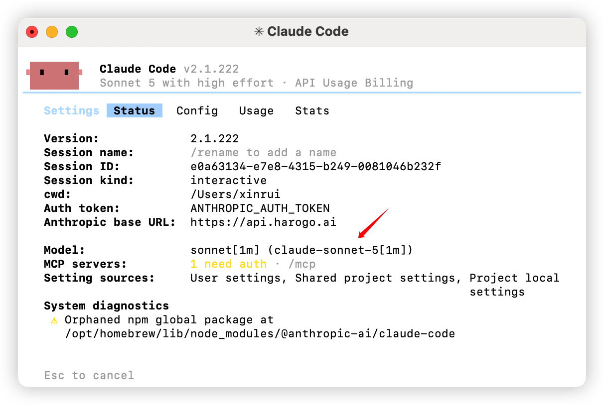

<Note>
**Deze handleiding gebruikt alleen Claude-modellen.** Claude Code kan de Claude-modellen (Claude Opus 5.5, Claude Sonnet 5.5, Claude Haiku 5.5) en de modellen zonder clientbeperking (GLM, Qwen, Kimi, MiniMax, DeepSeek) gebruiken. GPT-modellen zijn niet beschikbaar in Claude Code — zie [Codex](/nl/codex).
</Note>

### 1. Claude Code installeren

#### Lokale installatie

<CodeGroup>

```shellscript macOS
curl -fsSL https://claude.ai/install.sh | bash
```

```shellscript Windows
irm https://claude.ai/install.ps1 | iex
```

</CodeGroup>

#### Installeren via npm

Vereist [Node.js 18 of hoger](https://nodejs.org/en/download/)

```shellscript
npm install -g @anthropic-ai/claude-code
```

### 2. De Harogo-API configureren

Stel de volgende omgevingsvariabelen in om via de Anthropic-compatibele API verbinding te maken met de modeldienst van Harogo.

1. Stel `ANTHROPIC_BASE_URL` in op `https://api.harogo.ai/`
2. Stel `ANTHROPIC_AUTH_TOKEN` in op de API-key die je via het [Harogo-platform](https://console.harogo.ai/keys) hebt gekregen
3. Stel `ANTHROPIC_MODEL` in op een Claude-model dat Harogo ondersteunt, bijvoorbeeld `claude-sonnet-5-5`.

<Tabs>
  <Tab title="macOS">
    1. Voer de volgende opdracht uit in je terminal om je standaardshell te controleren.

    ```shellscript
    echo $SHELL
    ```

    2. Stel de omgevingsvariabelen in op basis van je shell:

    <CodeGroup>

    ```shellscript Zsh
    # Vervang <HAROGO_API_KEY> door de echte key van je Harogo-platform
    echo 'export ANTHROPIC_BASE_URL="https://api.harogo.ai"' >> ~/.zshrc
    echo 'export ANTHROPIC_AUTH_TOKEN="<HAROGO_API_KEY>"' >> ~/.zshrc
    echo 'export ANTHROPIC_MODEL="claude-sonnet-5-5"' >> ~/.zshrc
    ```

    ```shellscript Bash
    # Vervang <HAROGO_API_KEY> door de echte key van je Harogo-platform
    echo 'export ANTHROPIC_BASE_URL="https://api.harogo.ai"' >> ~/.bash_profile
    echo 'export ANTHROPIC_AUTH_TOKEN="<HAROGO_API_KEY>"' >> ~/.bash_profile
    echo 'export ANTHROPIC_MODEL="claude-sonnet-5-5"' >> ~/.bash_profile
    ```

    </CodeGroup>

    3. Voer de volgende opdracht uit in je terminal om de omgevingsvariabelen te activeren.

    <CodeGroup>

    ```shellscript Zsh
    source ~/.zshrc
    ```

    ```shellscript Bash
    source ~/.bash_profile
    ```

    </CodeGroup>

    4. Open een nieuwe terminal en voer de volgende opdrachten uit om te controleren of de omgevingsvariabelen actief zijn.

    ```shellscript
    echo $ANTHROPIC_BASE_URL
    test -n "$ANTHROPIC_AUTH_TOKEN" && echo "ANTHROPIC_AUTH_TOKEN is set"
    echo $ANTHROPIC_MODEL
    ```
  </Tab>
  <Tab title="Windows">
    Op Windows kun je de Base URL en [API-key](https://console.harogo.ai/keys) van Harogo via CMD of PowerShell als omgevingsvariabelen instellen.

    <Tabs>
      <Tab title="CMD">
        1. Voer de volgende opdracht uit in CMD om de omgevingsvariabelen in te stellen.

        ```shellscript
        REM Vervang <HAROGO_API_KEY> door de echte key van je Harogo-platform
        setx ANTHROPIC_AUTH_TOKEN "<HAROGO_API_KEY>"
        setx ANTHROPIC_BASE_URL "https://api.harogo.ai"
        setx ANTHROPIC_MODEL "claude-sonnet-5-5"
        ```

        2. Open een nieuw CMD-venster en voer de volgende opdrachten uit om te controleren of de omgevingsvariabelen actief zijn.

        ```shellscript
        if defined ANTHROPIC_AUTH_TOKEN echo ANTHROPIC_AUTH_TOKEN is set
        echo %ANTHROPIC_BASE_URL%
        echo %ANTHROPIC_MODEL%
        ```
      </Tab>
      <Tab title="PowerShell">
        1. Voer de volgende opdracht uit in PowerShell om de omgevingsvariabelen in te stellen.

        ```shellscript
        # Vervang <HAROGO_API_KEY> door de echte key van je Harogo-platform
        [Environment]::SetEnvironmentVariable("ANTHROPIC_AUTH_TOKEN", "<HAROGO_API_KEY>", [EnvironmentVariableTarget]::User)
        [Environment]::SetEnvironmentVariable("ANTHROPIC_BASE_URL", "https://api.harogo.ai", [EnvironmentVariableTarget]::User)
        [Environment]::SetEnvironmentVariable("ANTHROPIC_MODEL", "claude-sonnet-5-5", [EnvironmentVariableTarget]::User)
        ```

        2. Open een nieuw PowerShell-venster en voer de volgende opdrachten uit om te controleren of de omgevingsvariabelen actief zijn.

        ```shellscript
        if ($env:ANTHROPIC_AUTH_TOKEN) { "ANTHROPIC_AUTH_TOKEN is set" }
        echo $env:ANTHROPIC_BASE_URL
        echo $env:ANTHROPIC_MODEL
        ```
      </Tab>
    </Tabs>
  </Tab>
</Tabs>

<Note>
  Ga je Claude Code beheren via CC Switch, dan raden we aan om niet daarnaast ook globale waarden voor `ANTHROPIC_AUTH_TOKEN`, `ANTHROPIC_BASE_URL` of `ANTHROPIC_MODEL` in te stellen. Omgevingsvariabelen op systeem- of gebruikersniveau kunnen de aanbiedersconfiguratie overschrijven die CC Switch wegschrijft. De interface toont dan de juiste aanbieder als geselecteerd, terwijl Claude Code in werkelijkheid nog met een oude key of een oud model draait.
</Note>

### 3. De configuratie controleren

Stuur na het instellen van de omgevingsvariabelen of CC Switch eerst één minimale aanvraag om te bevestigen dat de key, het model en het Anthropic-compatibele endpoint werken, voordat je aan een langere sessie begint.

<CodeGroup>

```bash macOS/Linux
curl https://api.harogo.ai/v1/messages \
  -H "content-type: application/json" \
  -H "anthropic-version: 2023-06-01" \
  -H "x-api-key: $ANTHROPIC_AUTH_TOKEN" \
  -d '{
    "model": "claude-sonnet-5-5",
    "max_tokens": 16,
    "messages": [{"role": "user", "content": "1+1, output only the answer"}]
  }'
```

```powershell Windows
curl.exe https://api.harogo.ai/v1/messages `
  -H "content-type: application/json" `
  -H "anthropic-version: 2023-06-01" `
  -H "x-api-key: $env:ANTHROPIC_AUTH_TOKEN" `
  -d "{\"model\":\"claude-sonnet-5-5\",\"max_tokens\":16,\"messages\":[{\"role\":\"user\",\"content\":\"1+1, output only the answer\"}]}"
```

</CodeGroup>

### 4. Claude Code gebruiken

Ga na de configuratie naar je werkmap en voer in je terminal de opdracht `claude` uit om te beginnen.

```bash
$ cd /path/your-project
> claude
```

Zie je bij het opstarten `Not logged in · Please run /login`, of kom je in de inlogflow van Anthropic terecht, dan heeft Claude Code meestal geen werkende Harogo-configuratie opgepikt, of is de onboarding bij de eerste start nog niet afgerond. Controleer eerst of de minimale aanvraag uit de vorige stap `2` teruggeeft, en of `ANTHROPIC_AUTH_TOKEN`, `ANTHROPIC_BASE_URL` of `ANTHROPIC_MODEL` worden overschreven door oude globale omgevingsvariabelen. Werkt de key aantoonbaar en word je toch naar de inlogflow gestuurd, dan kun je de onboarding overslaan met de onderstaande stappen:


1. Zoek het bestand `.claude.json` in je thuismap:
   - macOS / Linux: `~/.claude.json`
   - Windows: `C:\Users\%USERNAME%\.claude.json`
2. Zet het veld `hasCompletedOnboarding` op `true`

```json
{
  "hasCompletedOnboarding": true
}
```

3. Sla het bestand op en voer `claude` opnieuw uit in je terminal.

#### (Optioneel) Meer manieren om het model te configureren

Claude Code ondersteunt de volgende manieren om het model te configureren, **gesorteerd van hoogste naar laagste prioriteit**. Een instelling met een hogere prioriteit overschrijft een instelling met een lagere prioriteit.

1. **Tijdens een gesprek:** gebruik de opdracht `/model <model-name>` om van model te wisselen. Handig voor een eenmalige wissel.

```text
/model claude-sonnet-5-5
```

2. **Bij het starten van Claude Code:** geef met `claude --model <model-name>` een model op. Handig voor één sessie.

```text
claude --model claude-sonnet-5-5
```

3. **Omgevingsvariabelen instellen:** configureer modellen in verschillende niveaus op basis van de complexiteit van de taak, waarna Claude Code automatisch het juiste model voor de taak kiest. Geldt globaal.

```shellscript
export ANTHROPIC_DEFAULT_OPUS_MODEL="claude-opus-5-5"
export ANTHROPIC_DEFAULT_SONNET_MODEL="claude-sonnet-5-5"
export ANTHROPIC_DEFAULT_HAIKU_MODEL="claude-haiku-5-5"
```

Hierbij geldt:

- `ANTHROPIC_DEFAULT_OPUS_MODEL`: voor complexe redenering, architectuurontwerp en andere zware taken.
- `ANTHROPIC_DEFAULT_SONNET_MODEL`: voor het schrijven van code, het bouwen van features en andere dagelijkse taken.
- `ANTHROPIC_DEFAULT_HAIKU_MODEL`: voor syntaxcontroles, bestanden zoeken en andere eenvoudige taken.

4. **Permanent instellen in settings.json:** schrijf de modelconfiguratie naar het gebruikersconfiguratiebestand van Claude Code (bijv. `~/.claude/settings.json`, of `C:\Users\%USERNAME%\.claude\settings.json` op Windows) of naar een configuratie op projectniveau, voor een permanente instelling op gebruikers- of projectniveau.

## Configureren via CC Switch

1. Start CC Switch, selecteer links **Claude Code** en klik op “Aanbieder toevoegen” (Add Provider).


2. Kies in de lijst met voorinstellingen “Aangepaste configuratie” (Custom Configuration) als aanbieder.


3. Vul de naam van de aanbieder, de API-key, het endpoint ([https://api.harogo.ai](https://api.harogo.ai)) enzovoort in. Klik op “Toevoegen” (Add) zodra alles is ingevuld.


4. Selecteer op het startscherm “harogo” in de lijst met aanbieders en klik op “Gebruiken” (Use).


<Frame>
  
  
</Frame>

<Frame>
  
</Frame>

Tip: typ in Claude Code in je terminal <kbd>/status</kbd> om het model-ID te controleren, of <kbd>/models</kbd> om een ander geconfigureerd model te kiezen.

<Warning>
  Meldt CC Switch “Conflict met systeemomgevingsvariabelen gedetecteerd” (System environment variable conflict detected), pak dan eerst `ANTHROPIC_AUTH_TOKEN`, `ANTHROPIC_BASE_URL` en `ANTHROPIC_MODEL` aan. Deze globale variabelen overschrijven de huidige aanbiedersconfiguratie. Een placeholderwaarde zoals `ANTHROPIC_AUTH_TOKEN=<HAROGO_API_KEY>` laat de authenticatie direct mislukken. Weet je zeker dat je de globale variabelen niet meer nodig hebt, verwijder dan de conflicterende items in CC Switch, of verwijder de omgevingsvariabelen op systeem- of gebruikersniveau handmatig en start je terminal opnieuw.
</Warning>
