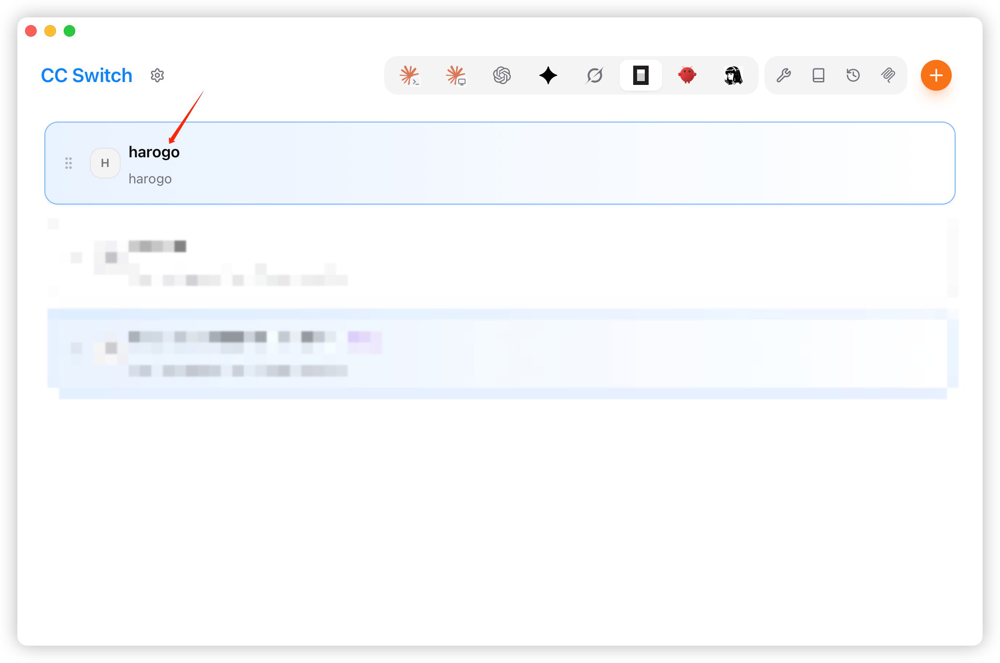

Controleer voor de installatie of je systeem aan de volgende vereisten voldoet:

- **Node.js ≥ 18.0.0**
- Een pakketbeheerder voor je platform (optioneel):
  - macOS / Linux: `brew`
  - Arch Linux: `paru`
  - Windows: `choco`, `winget` of `scoop`

## 1. OpenCode installeren

Kies de installatiemethode die past bij je systeem en tools.

### 1. Installeren via Node.js

```text
# Snelle installatie via curl-script
curl -fsSL https://opencode.ai/install | bash

# Met NPM
npm install -g opencode-ai

# Met Bun
bun install -g opencode-ai

# Met PNPM
pnpm install -g opencode-ai

# Met Yarn
yarn global add opencode-ai
```

---

### 2. Met Homebrew (macOS / Linux)

```text
brew install sst/tap/opencode
```

---

### 3. Met Paru (Arch Linux)

```text
paru -S opencode-bin
```

---

### 4. Installeren op Windows

Windows-gebruikers kunnen OpenCode op een van de volgende manieren installeren:

```text
# Chocolatey
choco install opencode

# WinGet
winget install opencode

# Scoop
scoop bucket add extras
scoop install extras/opencode

# Of via NPM (vereist Node.js) – let op: hiervoor zijn beheerdersrechten nodig
npm install -g opencode-ai
```

---

## 2. OpenCode configureren via CC Switch

1. Start CC Switch, selecteer links OpenCode en klik op “Aanbieder toevoegen” (Add Provider).

<Frame>
  
</Frame>

2. Kies in de lijst met voorinstellingen “Aangepaste configuratie” (Custom Configuration) als aanbieder.

<Frame>
  
</Frame>

3. Vul de aanbiederskey, de naam, de API-key, het endpoint (`https://api.harogo.ai/v1`) enzovoort in.

<Frame>
  
  
</Frame>

4. Vul de modelgegevens in en sla op.

<Frame>
  
  
</Frame>

5. Selecteer op het startscherm “harogo” in de lijst met aanbieders en klik op “Gebruiken” (Use).

<Frame>
  
</Frame>

---

## 3. Het model gebruiken

### 1. De installatie controleren

Met de volgende opdracht controleer je of OpenCode correct is geïnstalleerd en geconfigureerd:

```text
opencode
```


### 2. Een model selecteren

Typ `/models`, zoek naar `harogo` en kies het model dat je wilt gebruiken.


