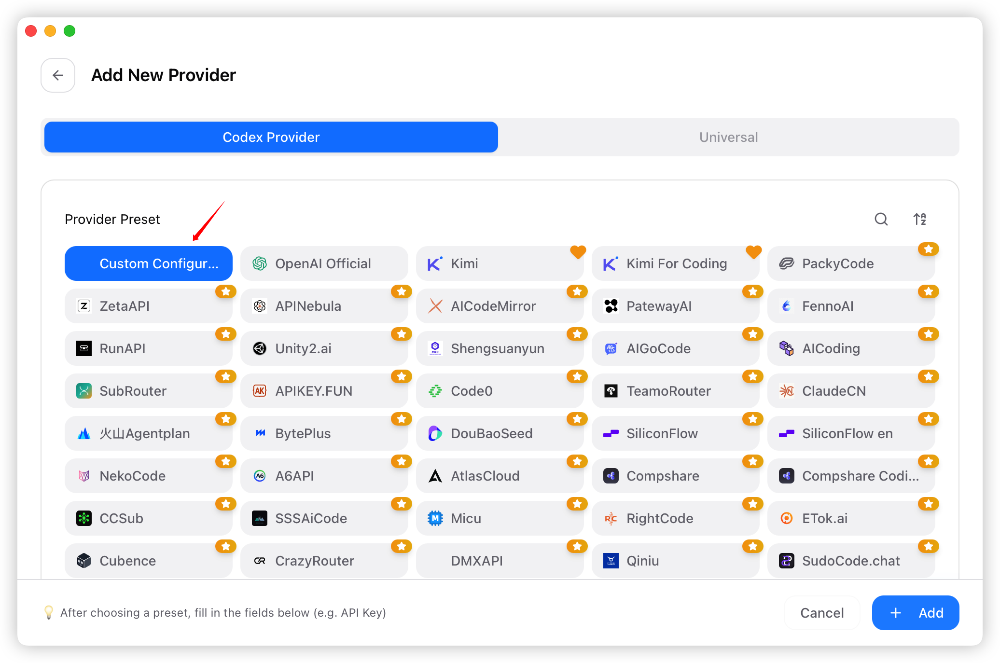

<Note>
**Ten przewodnik korzysta wyłącznie z modeli GPT.** Codex może uruchamiać modele GPT (GPT-6 Luna, GPT-6 Sol, GPT-6.1 Sol, GPT-6 Astra, GPT-6.1 Terra) oraz modele bez ograniczeń klienta (GLM, Qwen, Kimi, MiniMax, DeepSeek). Modele Claude nie są dostępne w Codex — zobacz [Claude Code](/pl/claude-code).
</Note>

## Instalacja

### Pobieranie z oficjalnej strony (macOS)

[https://openai.com/codex/](https://openai.com/codex/)

### Instalacja z wiersza poleceń

```bash
npm install -g @openai/codex
```

## Konfiguracja zmiennych środowiskowych

### Konfiguracja przez plik konfiguracyjny

1. Otwórz plik `~/.codex/config.toml` i dodaj następującą zawartość:

```toml
profile = "harogo"

[model_providers.harogo]
name = "harogo"
base_url = "https://api.harogo.ai/v1"
personality = "pragmatic"
wire_api = "responses"

[profiles.harogo]
model = "gpt-6.1-sol"
model_provider = "harogo"
model_reasoning_effort = "high"
```

2. Otwórz plik `~/.codex/auth.json` i zmień jego zawartość w następujący sposób:

```json
{
  "OPENAI_API_KEY": "HAROGO_API_KEY"
}
```

### Konfiguracja przez cc-switch

1. Uruchom CC-Switch i dodaj dostawcę.


2. Z listy gotowych ustawień wybierz „Konfiguracja niestandardowa” (Custom Configuration).



3. Uzupełnij m.in. nazwę dostawcy, klucz API i endpoint ([https://api.harogo.ai/v1](https://api.harogo.ai/v1)). Po wypełnieniu wszystkich pól kliknij „Dodaj” (Add).


4. Po powrocie na ekran główny wybierz „harogo” i kliknij „Włącz” (Enable), aby zacząć korzystać.


## Korzystanie z Codex

### W terminalu

1. Otwórz terminal, przejdź do katalogu projektu i uruchom polecenie `codex`.

```bash
cd /path/to/your/project
codex
```

2. Ustaw uprawnienia według potrzeb.


3. Wpisz polecenie w języku naturalnym — jeśli otrzymasz poprawną odpowiedź, konfiguracja zakończyła się sukcesem.
