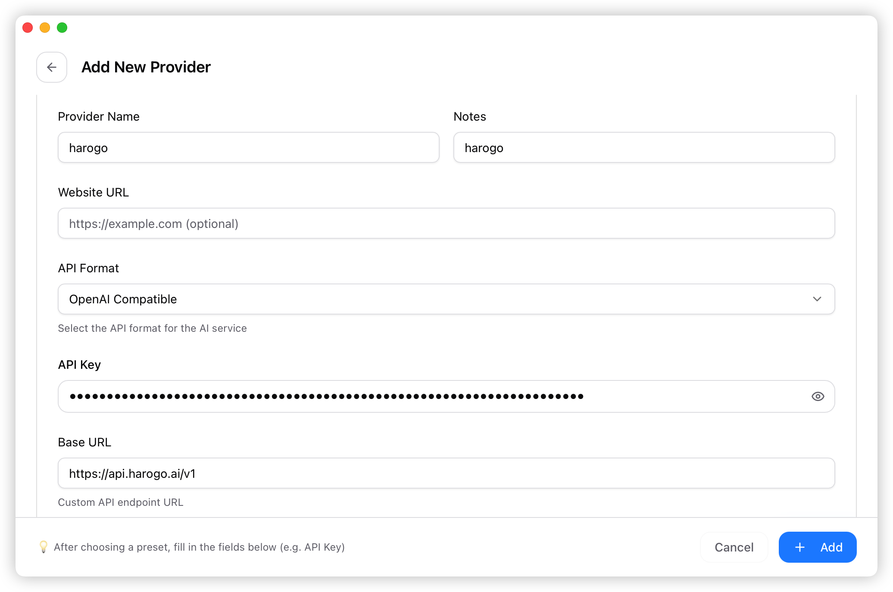

Przed instalacją upewnij się, że Twój system spełnia następujące wymagania:

- **Node.js ≥ 18.0.0**
- Menedżer pakietów dla Twojej platformy (opcjonalnie):
  - macOS / Linux: `brew`
  - Arch Linux: `paru`
  - Windows: `choco`, `winget` lub `scoop`

## 1. Zainstaluj OpenCode

Wybierz metodę instalacji odpowiednią dla Twojego systemu i narzędzi.

### 1. Instalacja przez Node.js

```text
# Szybka instalacja skryptem curl
curl -fsSL https://opencode.ai/install | bash

# Przez NPM
npm install -g opencode-ai

# Przez Bun
bun install -g opencode-ai

# Przez PNPM
pnpm install -g opencode-ai

# Przez Yarn
yarn global add opencode-ai
```

---

### 2. Przez Homebrew (macOS / Linux)

```text
brew install sst/tap/opencode
```

---

### 3. Przez Paru (Arch Linux)

```text
paru -S opencode-bin
```

---

### 4. Instalacja w systemie Windows

Użytkownicy systemu Windows mogą zainstalować OpenCode w jeden z następujących sposobów:

```text
# Chocolatey
choco install opencode

# WinGet
winget install opencode

# Scoop
scoop bucket add extras
scoop install extras/opencode

# Lub przez NPM (wymaga Node.js) — uwaga: wymaga uprawnień administratora
npm install -g opencode-ai
```

---

## 2. Skonfiguruj OpenCode przez CC Switch

1. Uruchom CC Switch, wybierz po lewej stronie OpenCode, a następnie kliknij „Dodaj dostawcę” (Add Provider).

<Frame>
  
</Frame>

2. Z listy gotowych ustawień wybierz jako dostawcę „Konfiguracja niestandardowa” (Custom Configuration).

<Frame>
  
</Frame>

3. Uzupełnij m.in. klucz dostawcy, nazwę, klucz API i endpoint (`https://api.harogo.ai/v1`).

<Frame>
  
  
</Frame>

4. Uzupełnij informacje o modelu, a następnie zapisz.

<Frame>
  
  
</Frame>

5. Po powrocie na ekran główny wybierz z listy dostawców „harogo” i kliknij „Użyj” (Use).

<Frame>
  
</Frame>

---

## 3. Korzystanie z modelu

### 1. Sprawdź instalację

Za pomocą następującego polecenia możesz sprawdzić, czy OpenCode został poprawnie zainstalowany i skonfigurowany:

```text
opencode
```


### 2. Wybierz model

Wpisz `/models`, wyszukaj `harogo` i wybierz model, którego chcesz używać.


