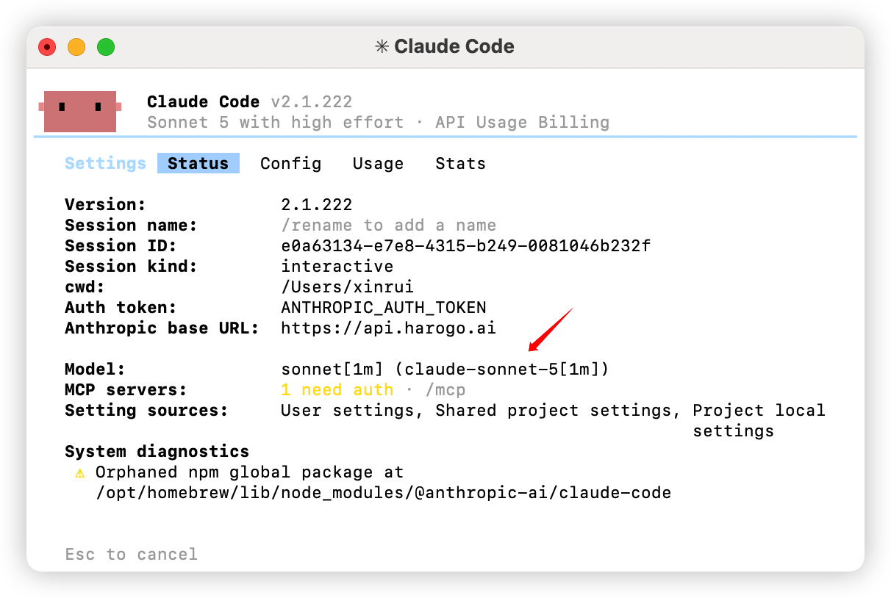

<Note>
**Este guia usa apenas modelos Claude.** O Claude Code pode executar os modelos Claude (Claude Opus 5.5, Claude Sonnet 5.5, Claude Haiku 5.5) e os modelos sem restrição de cliente (GLM, Qwen, Kimi, MiniMax, DeepSeek). Modelos GPT não estão disponíveis no Claude Code — veja [Codex](/pt/codex).
</Note>

### 1. Instalar o Claude Code

#### Instalação local

<CodeGroup>

```shellscript macOS
curl -fsSL https://claude.ai/install.sh | bash
```

```shellscript Windows
irm https://claude.ai/install.ps1 | iex
```

</CodeGroup>

#### Instalar via npm

Requer [Node.js 18 ou posterior](https://nodejs.org/en/download/)

```shellscript
npm install -g @anthropic-ai/claude-code
```

### 2. Configurar a API da Harogo

Para se conectar ao serviço de modelos da Harogo pela API compatível com a Anthropic, defina as seguintes variáveis de ambiente.

1. Defina `ANTHROPIC_BASE_URL` como `https://api.harogo.ai/`
2. Defina `ANTHROPIC_AUTH_TOKEN` com a chave de API obtida na [plataforma Harogo](https://console.harogo.ai/keys)
3. Defina `ANTHROPIC_MODEL` com um modelo Claude suportado pela Harogo, por exemplo `claude-sonnet-5-5`.

<Tabs>
  <Tab title="macOS">
    1. Execute o comando a seguir no terminal para verificar seu shell padrão.

    ```shellscript
    echo $SHELL
    ```

    2. Defina as variáveis de ambiente de acordo com o tipo de shell:

    <CodeGroup>

    ```shellscript Zsh
    # Substitua <HAROGO_API_KEY> pela chave real da sua plataforma Harogo
    echo 'export ANTHROPIC_BASE_URL="https://api.harogo.ai"' >> ~/.zshrc
    echo 'export ANTHROPIC_AUTH_TOKEN="<HAROGO_API_KEY>"' >> ~/.zshrc
    echo 'export ANTHROPIC_MODEL="claude-sonnet-5-5"' >> ~/.zshrc
    ```

    ```shellscript Bash
    # Substitua <HAROGO_API_KEY> pela chave real da sua plataforma Harogo
    echo 'export ANTHROPIC_BASE_URL="https://api.harogo.ai"' >> ~/.bash_profile
    echo 'export ANTHROPIC_AUTH_TOKEN="<HAROGO_API_KEY>"' >> ~/.bash_profile
    echo 'export ANTHROPIC_MODEL="claude-sonnet-5-5"' >> ~/.bash_profile
    ```

    </CodeGroup>

    3. Execute o comando a seguir no terminal para aplicar as variáveis de ambiente.

    <CodeGroup>

    ```shellscript Zsh
    source ~/.zshrc
    ```

    ```shellscript Bash
    source ~/.bash_profile
    ```

    </CodeGroup>

    4. Abra um novo terminal e execute os comandos a seguir para confirmar que as variáveis de ambiente foram aplicadas.

    ```shellscript
    echo $ANTHROPIC_BASE_URL
    test -n "$ANTHROPIC_AUTH_TOKEN" && echo "ANTHROPIC_AUTH_TOKEN is set"
    echo $ANTHROPIC_MODEL
    ```
  </Tab>
  <Tab title="Windows">
    No Windows, você pode definir a Base URL e a [chave de API](https://console.harogo.ai/keys) da Harogo como variáveis de ambiente usando o CMD ou o PowerShell.

    <Tabs>
      <Tab title="CMD">
        1. Execute o comando a seguir no CMD para definir as variáveis de ambiente.

        ```shellscript
        REM Substitua <HAROGO_API_KEY> pela chave real da sua plataforma Harogo
        setx ANTHROPIC_AUTH_TOKEN "<HAROGO_API_KEY>"
        setx ANTHROPIC_BASE_URL "https://api.harogo.ai"
        setx ANTHROPIC_MODEL "claude-sonnet-5-5"
        ```

        2. Abra uma nova janela do CMD e execute os comandos a seguir para confirmar que as variáveis de ambiente foram aplicadas.

        ```shellscript
        if defined ANTHROPIC_AUTH_TOKEN echo ANTHROPIC_AUTH_TOKEN is set
        echo %ANTHROPIC_BASE_URL%
        echo %ANTHROPIC_MODEL%
        ```
      </Tab>
      <Tab title="PowerShell">
        1. Execute o comando a seguir no PowerShell para definir as variáveis de ambiente.

        ```shellscript
        # Substitua <HAROGO_API_KEY> pela chave real da sua plataforma Harogo
        [Environment]::SetEnvironmentVariable("ANTHROPIC_AUTH_TOKEN", "<HAROGO_API_KEY>", [EnvironmentVariableTarget]::User)
        [Environment]::SetEnvironmentVariable("ANTHROPIC_BASE_URL", "https://api.harogo.ai", [EnvironmentVariableTarget]::User)
        [Environment]::SetEnvironmentVariable("ANTHROPIC_MODEL", "claude-sonnet-5-5", [EnvironmentVariableTarget]::User)
        ```

        2. Abra uma nova janela do PowerShell e execute os comandos a seguir para confirmar que as variáveis de ambiente foram aplicadas.

        ```shellscript
        if ($env:ANTHROPIC_AUTH_TOKEN) { "ANTHROPIC_AUTH_TOKEN is set" }
        echo $env:ANTHROPIC_BASE_URL
        echo $env:ANTHROPIC_MODEL
        ```
      </Tab>
    </Tabs>
  </Tab>
</Tabs>

<Note>
  Se você for gerenciar o Claude Code pelo CC Switch, recomendamos não definir também valores globais de `ANTHROPIC_AUTH_TOKEN`, `ANTHROPIC_BASE_URL` ou `ANTHROPIC_MODEL`. Variáveis de ambiente no nível do sistema ou do usuário podem sobrescrever a configuração de provedor gravada pelo CC Switch; assim, a interface mostra o provedor correto selecionado enquanto o Claude Code continua, na prática, usando uma chave ou um modelo antigos.
</Note>

### 3. Verificar a configuração

Depois de configurar as variáveis de ambiente ou o CC Switch, envie primeiro uma solicitação mínima para confirmar que a chave, o modelo e o endpoint compatível com a Anthropic estão funcionando, antes de iniciar uma sessão mais longa.

<CodeGroup>

```bash macOS/Linux
curl https://api.harogo.ai/v1/messages \
  -H "content-type: application/json" \
  -H "anthropic-version: 2023-06-01" \
  -H "x-api-key: $ANTHROPIC_AUTH_TOKEN" \
  -d '{
    "model": "claude-sonnet-5-5",
    "max_tokens": 16,
    "messages": [{"role": "user", "content": "1+1, output only the answer"}]
  }'
```

```powershell Windows
curl.exe https://api.harogo.ai/v1/messages `
  -H "content-type: application/json" `
  -H "anthropic-version: 2023-06-01" `
  -H "x-api-key: $env:ANTHROPIC_AUTH_TOKEN" `
  -d "{\"model\":\"claude-sonnet-5-5\",\"max_tokens\":16,\"messages\":[{\"role\":\"user\",\"content\":\"1+1, output only the answer\"}]}"
```

</CodeGroup>

### 4. Começar a usar o Claude Code

Depois de configurar, vá até o diretório de trabalho e execute o comando `claude` no terminal para começar.

```bash
$ cd /path/your-project
> claude
```

Se aparecer `Not logged in · Please run /login` ao iniciar, ou se você for levado ao fluxo de login da Anthropic, normalmente isso significa que o Claude Code não carregou uma configuração válida da Harogo ou que a configuração inicial não foi concluída. Primeiro, confirme que a solicitação mínima da etapa anterior retorna `2` e verifique se `ANTHROPIC_AUTH_TOKEN`, `ANTHROPIC_BASE_URL` ou `ANTHROPIC_MODEL` estão sendo sobrescritas por variáveis de ambiente globais antigas. Se a chave já estiver funcionando e você ainda for levado ao fluxo de login, pule a configuração inicial com as etapas abaixo:


1. Localize o arquivo `.claude.json` no seu diretório pessoal:
   - macOS / Linux: `~/.claude.json`
   - Windows: `C:\Users\%USERNAME%\.claude.json`
2. Defina o campo `hasCompletedOnboarding` como `true`

```json
{
  "hasCompletedOnboarding": true
}
```

3. Salve o arquivo e execute `claude` novamente no terminal.

#### (Opcional) Outras formas de configurar o modelo

O Claude Code permite configurar o modelo das seguintes formas, **listadas da maior para a menor prioridade**: uma configuração de maior prioridade sobrescreve uma de menor prioridade.

1. **Durante uma conversa:** execute o comando `/model <model-name>` para trocar de modelo. Ideal para uma troca pontual.

```text
/model claude-sonnet-5-5
```

2. **Ao iniciar o Claude Code:** execute `claude --model <model-name>` para especificar um modelo. Ideal para uma única sessão.

```text
claude --model claude-sonnet-5-5
```

3. **Definir variáveis de ambiente:** configure modelos de níveis diferentes conforme a complexidade da tarefa, e o Claude Code escolherá automaticamente o mais adequado. Vale globalmente.

```shellscript
export ANTHROPIC_DEFAULT_OPUS_MODEL="claude-opus-5-5"
export ANTHROPIC_DEFAULT_SONNET_MODEL="claude-sonnet-5-5"
export ANTHROPIC_DEFAULT_HAIKU_MODEL="claude-haiku-5-5"
```

Onde:

- `ANTHROPIC_DEFAULT_OPUS_MODEL`: para raciocínio complexo, design de arquitetura e outras tarefas de alta dificuldade.
- `ANTHROPIC_DEFAULT_SONNET_MODEL`: para escrever código, implementar funcionalidades e outras tarefas do dia a dia.
- `ANTHROPIC_DEFAULT_HAIKU_MODEL`: para verificação de sintaxe, busca de arquivos e outras tarefas simples.

4. **Definir permanentemente no settings.json:** grave a configuração do modelo no arquivo de configuração de usuário do Claude Code (por exemplo, `~/.claude/settings.json`, ou `C:\Users\%USERNAME%\.claude\settings.json` no Windows) ou em uma configuração de projeto, para uma definição permanente no nível do usuário ou do projeto.

## Configurar pelo CC Switch

1. Abra o CC Switch, selecione **Claude Code** à esquerda e clique em "Adicionar provedor" (Add Provider).


2. Na lista de predefinições, escolha "Configuração personalizada" (Custom Configuration) como provedor.


3. Preencha o nome do provedor, a chave de API, o endpoint ([https://api.harogo.ai](https://api.harogo.ai)) etc. Depois de preencher tudo, clique em "Adicionar" (Add).


4. De volta à tela inicial, selecione "harogo" na lista de provedores e clique em "Usar" (Use).


<Frame>
  
  
</Frame>

<Frame>
  
</Frame>

Dica: com o Claude Code aberto no terminal, digite <kbd>/status</kbd> para ver o ID do modelo ou <kbd>/models</kbd> para escolher outro modelo configurado.

<Warning>
  Se o CC Switch mostrar "Conflito de variáveis de ambiente do sistema detectado" (System environment variable conflict detected), resolva primeiro `ANTHROPIC_AUTH_TOKEN`, `ANTHROPIC_BASE_URL` e `ANTHROPIC_MODEL`. Essas variáveis globais sobrescrevem a configuração atual do provedor, e um valor de espaço reservado como `ANTHROPIC_AUTH_TOKEN=<HAROGO_API_KEY>` faz a autenticação falhar de imediato. Quando tiver certeza de que não precisa mais das variáveis globais, remova as entradas conflitantes no CC Switch ou exclua manualmente as variáveis de ambiente do sistema/usuário e reinicie o terminal.
</Warning>
