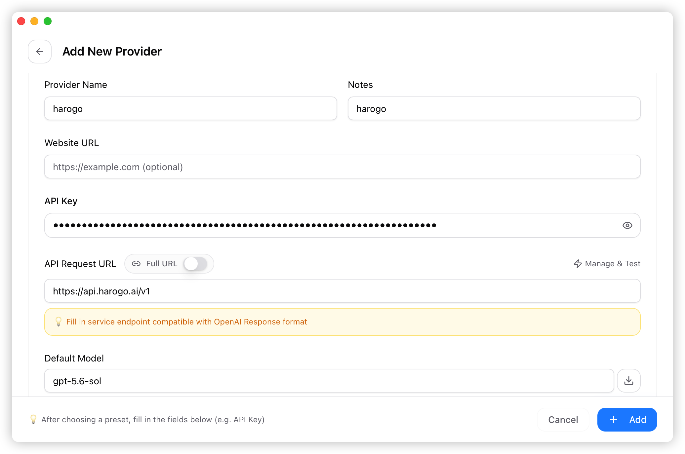
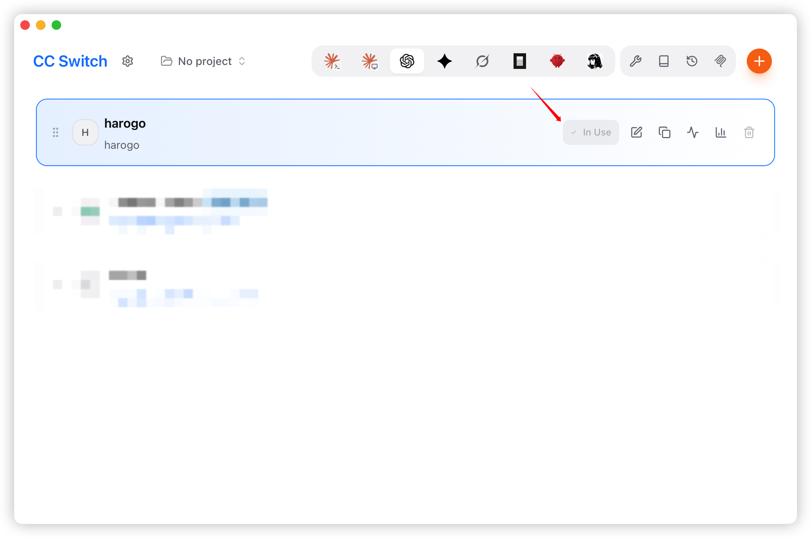

<Note>
**Este guia usa apenas modelos GPT.** O Codex pode executar os modelos GPT (GPT-6 Luna, GPT-6.2 Sol, GPT-6.2 Astra, GPT-6.1 Terra) e os modelos sem restrição de cliente (GLM, Qwen, Kimi, MiniMax, DeepSeek). Modelos Claude não estão disponíveis no Codex — veja [Claude Code](/pt/claude-code).
</Note>

## Instalação

### Baixar do site oficial (macOS)

[https://openai.com/codex/](https://openai.com/codex/)

### Instalar pela linha de comando

```bash
npm install -g @openai/codex
```

## Configuração do ambiente

### Configurar pelo arquivo de configuração

1. Edite o arquivo `~/.codex/config.toml` e adicione o seguinte:

```toml
profile = "harogo"

[model_providers.harogo]
name = "harogo"
base_url = "https://api.harogo.ai/v1"
personality = "pragmatic"
wire_api = "responses"

[profiles.harogo]
model = "gpt-6.2-sol"
model_provider = "harogo"
model_reasoning_effort = "high"
```

2. Edite o arquivo `~/.codex/auth.json` e atualize-o da seguinte forma:

```json
{
  "OPENAI_API_KEY": "HAROGO_API_KEY"
}
```

### Configurar pelo cc-switch

1. Abra o CC-Switch e adicione um provedor.


2. Na lista de predefinições, escolha "Configuração personalizada" (Custom Configuration).


3. Preencha o nome do provedor, a chave de API, o endpoint ([https://api.harogo.ai/v1](https://api.harogo.ai/v1)) etc. Depois de preencher tudo, clique em "Adicionar" (Add).



4. De volta à tela inicial, selecione "harogo" e clique em "Ativar" (Enable) para começar a usar.



## Usar o Codex

### No terminal

1. Abra um terminal, navegue até o diretório do seu projeto e execute o comando `codex`.

```bash
cd /path/to/your/project
codex
```

2. Defina as permissões conforme necessário.


3. Digite um prompt em linguagem natural. Se receber uma resposta normal, a configuração foi concluída com sucesso.
