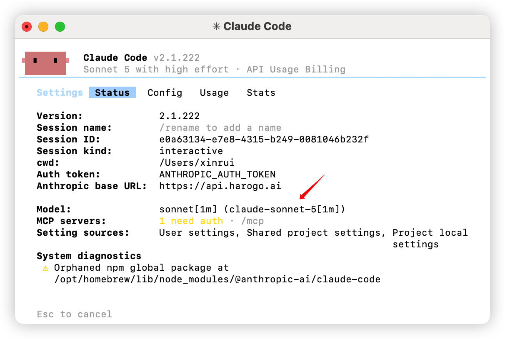

<Note>
**В этом руководстве используются только модели Claude.** Claude Code может запускать модели Claude (Claude Opus 5.5, Claude Sonnet 5.5, Claude Haiku 5.5) и модели без ограничений по клиенту (GLM, Qwen, Kimi, MiniMax, DeepSeek). Модели GPT в Claude Code недоступны — см. [Codex](/ru/codex).
</Note>

### 1. Установка Claude Code

#### Локальная установка

<CodeGroup>

```shellscript macOS
curl -fsSL https://claude.ai/install.sh | bash
```

```shellscript Windows
irm https://claude.ai/install.ps1 | iex
```

</CodeGroup>

#### Установка через npm

Требуется [Node.js 18 или новее](https://nodejs.org/en/download/)

```shellscript
npm install -g @anthropic-ai/claude-code
```

### 2. Настройка Harogo API

Чтобы подключиться к моделям Harogo через API, совместимый с Anthropic, задайте следующие переменные окружения.

1. Задайте для `ANTHROPIC_BASE_URL` значение `https://api.harogo.ai/`
2. Задайте для `ANTHROPIC_AUTH_TOKEN` API-ключ, полученный на [платформе Harogo](https://console.harogo.ai/keys)
3. Задайте для `ANTHROPIC_MODEL` модель Claude, которую поддерживает Harogo, например `claude-sonnet-5-5`.

<Tabs>
  <Tab title="macOS">
    1. Выполните в терминале следующую команду, чтобы узнать, какая оболочка используется по умолчанию.

    ```shellscript
    echo $SHELL
    ```

    2. Задайте переменные окружения в зависимости от типа оболочки:

    <CodeGroup>

    ```shellscript Zsh
    # Замените <HAROGO_API_KEY> на настоящий ключ с платформы Harogo
    echo 'export ANTHROPIC_BASE_URL="https://api.harogo.ai"' >> ~/.zshrc
    echo 'export ANTHROPIC_AUTH_TOKEN="<HAROGO_API_KEY>"' >> ~/.zshrc
    echo 'export ANTHROPIC_MODEL="claude-sonnet-5-5"' >> ~/.zshrc
    ```

    ```shellscript Bash
    # Замените <HAROGO_API_KEY> на настоящий ключ с платформы Harogo
    echo 'export ANTHROPIC_BASE_URL="https://api.harogo.ai"' >> ~/.bash_profile
    echo 'export ANTHROPIC_AUTH_TOKEN="<HAROGO_API_KEY>"' >> ~/.bash_profile
    echo 'export ANTHROPIC_MODEL="claude-sonnet-5-5"' >> ~/.bash_profile
    ```

    </CodeGroup>

    3. Выполните в терминале следующую команду, чтобы применить переменные окружения.

    <CodeGroup>

    ```shellscript Zsh
    source ~/.zshrc
    ```

    ```shellscript Bash
    source ~/.bash_profile
    ```

    </CodeGroup>

    4. Откройте новый терминал и выполните следующие команды, чтобы убедиться, что переменные окружения применились.

    ```shellscript
    echo $ANTHROPIC_BASE_URL
    test -n "$ANTHROPIC_AUTH_TOKEN" && echo "ANTHROPIC_AUTH_TOKEN is set"
    echo $ANTHROPIC_MODEL
    ```
  </Tab>
  <Tab title="Windows">
    В Windows базовый URL Harogo и [API-ключ](https://console.harogo.ai/keys) можно задать как переменные окружения через CMD или PowerShell.

    <Tabs>
      <Tab title="CMD">
        1. Выполните в CMD следующую команду, чтобы задать переменные окружения.

        ```shellscript
        REM Замените <HAROGO_API_KEY> на настоящий ключ с платформы Harogo
        setx ANTHROPIC_AUTH_TOKEN "<HAROGO_API_KEY>"
        setx ANTHROPIC_BASE_URL "https://api.harogo.ai"
        setx ANTHROPIC_MODEL "claude-sonnet-5-5"
        ```

        2. Откройте новое окно CMD и выполните следующие команды, чтобы убедиться, что переменные окружения применились.

        ```shellscript
        if defined ANTHROPIC_AUTH_TOKEN echo ANTHROPIC_AUTH_TOKEN is set
        echo %ANTHROPIC_BASE_URL%
        echo %ANTHROPIC_MODEL%
        ```
      </Tab>
      <Tab title="PowerShell">
        1. Выполните в PowerShell следующую команду, чтобы задать переменные окружения.

        ```shellscript
        # Замените <HAROGO_API_KEY> на настоящий ключ с платформы Harogo
        [Environment]::SetEnvironmentVariable("ANTHROPIC_AUTH_TOKEN", "<HAROGO_API_KEY>", [EnvironmentVariableTarget]::User)
        [Environment]::SetEnvironmentVariable("ANTHROPIC_BASE_URL", "https://api.harogo.ai", [EnvironmentVariableTarget]::User)
        [Environment]::SetEnvironmentVariable("ANTHROPIC_MODEL", "claude-sonnet-5-5", [EnvironmentVariableTarget]::User)
        ```

        2. Откройте новое окно PowerShell и выполните следующие команды, чтобы убедиться, что переменные окружения применились.

        ```shellscript
        if ($env:ANTHROPIC_AUTH_TOKEN) { "ANTHROPIC_AUTH_TOKEN is set" }
        echo $env:ANTHROPIC_BASE_URL
        echo $env:ANTHROPIC_MODEL
        ```
      </Tab>
    </Tabs>
  </Tab>
</Tabs>

<Note>
  Если вы собираетесь управлять Claude Code через CC Switch, рекомендуем не задавать дополнительно глобальные `ANTHROPIC_AUTH_TOKEN`, `ANTHROPIC_BASE_URL` и `ANTHROPIC_MODEL`. Системные или пользовательские переменные окружения могут переопределять конфигурацию провайдера, которую записывает CC Switch. В итоге в интерфейсе выбран правильный провайдер, а Claude Code на самом деле продолжает работать со старым ключом или старой моделью.
</Note>

### 3. Проверка конфигурации

После настройки переменных окружения или CC Switch сначала отправьте один минимальный запрос, чтобы убедиться, что ключ, модель и Anthropic-совместимый эндпоинт работают, и только потом начинайте долгую сессию.

<CodeGroup>

```bash macOS/Linux
curl https://api.harogo.ai/v1/messages \
  -H "content-type: application/json" \
  -H "anthropic-version: 2023-06-01" \
  -H "x-api-key: $ANTHROPIC_AUTH_TOKEN" \
  -d '{
    "model": "claude-sonnet-5-5",
    "max_tokens": 16,
    "messages": [{"role": "user", "content": "1+1, output only the answer"}]
  }'
```

```powershell Windows
curl.exe https://api.harogo.ai/v1/messages `
  -H "content-type: application/json" `
  -H "anthropic-version: 2023-06-01" `
  -H "x-api-key: $env:ANTHROPIC_AUTH_TOKEN" `
  -d "{\"model\":\"claude-sonnet-5-5\",\"max_tokens\":16,\"messages\":[{\"role\":\"user\",\"content\":\"1+1, output only the answer\"}]}"
```

</CodeGroup>

### 4. Начало работы с Claude Code

После настройки перейдите в рабочий каталог и выполните в терминале команду `claude`.

```bash
$ cd /path/your-project
> claude
```

Если при запуске появляется `Not logged in · Please run /login` или открывается процесс входа в Anthropic, обычно это значит, что Claude Code не подхватил рабочую конфигурацию Harogo или первичная настройка ещё не пройдена. Сначала убедитесь, что минимальный запрос из предыдущего шага возвращает `2`, и проверьте, не переопределяются ли `ANTHROPIC_AUTH_TOKEN`, `ANTHROPIC_BASE_URL` или `ANTHROPIC_MODEL` старыми глобальными переменными окружения. Если ключ точно работает, а вас всё равно отправляет на вход, пропустите первичную настройку, выполнив шаги ниже:


1. Найдите файл `.claude.json` в домашнем каталоге:
   - macOS / Linux: `~/.claude.json`
   - Windows: `C:\Users\%USERNAME%\.claude.json`
2. Установите для поля `hasCompletedOnboarding` значение `true`

```json
{
  "hasCompletedOnboarding": true
}
```

3. Сохраните файл и снова выполните `claude` в терминале.

#### (Необязательно) Другие способы настройки модели

Claude Code поддерживает следующие способы настройки модели, **перечисленные от высшего приоритета к низшему**: настройка с более высоким приоритетом переопределяет настройку с более низким.

1. **Во время диалога:** выполните команду `/model <model-name>`, чтобы сменить модель. Подходит для разового переключения.

```text
/model claude-sonnet-5-5
```

2. **При запуске Claude Code:** выполните `claude --model <model-name>`, чтобы указать модель. Подходит для одной сессии.

```text
claude --model claude-sonnet-5-5
```

3. **Через переменные окружения:** настройте модели разных уровней в зависимости от сложности задачи, и Claude Code будет автоматически выбирать подходящую. Действует глобально.

```shellscript
export ANTHROPIC_DEFAULT_OPUS_MODEL="claude-opus-5-5"
export ANTHROPIC_DEFAULT_SONNET_MODEL="claude-sonnet-5-5"
export ANTHROPIC_DEFAULT_HAIKU_MODEL="claude-haiku-5-5"
```

Где:

- `ANTHROPIC_DEFAULT_OPUS_MODEL`: для сложных рассуждений, проектирования архитектуры и других трудных задач.
- `ANTHROPIC_DEFAULT_SONNET_MODEL`: для написания кода, реализации функций и других повседневных задач.
- `ANTHROPIC_DEFAULT_HAIKU_MODEL`: для проверки синтаксиса, поиска по файлам и других простых задач.

4. **Постоянно в settings.json:** запишите конфигурацию модели в пользовательский файл конфигурации Claude Code (например, `~/.claude/settings.json` или `C:\Users\%USERNAME%\.claude\settings.json` в Windows) либо в конфигурацию проекта, чтобы закрепить настройку на уровне пользователя или проекта.

## Настройка через CC Switch

1. Запустите CC Switch, выберите слева **Claude Code** и нажмите «Добавить провайдера» (Add Provider).


2. В списке пресетов выберите в качестве провайдера «Пользовательская конфигурация» (Custom Configuration).


3. Укажите имя провайдера, API-ключ, эндпоинт ([https://api.harogo.ai](https://api.harogo.ai)) и другие данные. Заполнив все поля, нажмите «Добавить» (Add).


4. Вернитесь на главный экран, выберите «harogo» в списке провайдеров и нажмите «Использовать» (Use).


<Frame>
  
  
</Frame>

<Frame>
  
</Frame>

Совет: открыв Claude Code в терминале, введите <kbd>/status</kbd>, чтобы посмотреть ID модели, или <kbd>/models</kbd>, чтобы выбрать другую настроенную модель.

<Warning>
  Если CC Switch показывает «Обнаружен конфликт системных переменных окружения» (System environment variable conflict detected), сначала разберитесь с `ANTHROPIC_AUTH_TOKEN`, `ANTHROPIC_BASE_URL` и `ANTHROPIC_MODEL`. Эти глобальные переменные переопределяют текущую конфигурацию провайдера, а значение-заглушка вроде `ANTHROPIC_AUTH_TOKEN=<HAROGO_API_KEY>` сразу приведёт к ошибке аутентификации. Убедившись, что глобальные переменные больше не нужны, удалите конфликтующие записи в CC Switch или вручную удалите системные/пользовательские переменные окружения и перезапустите терминал.
</Warning>
