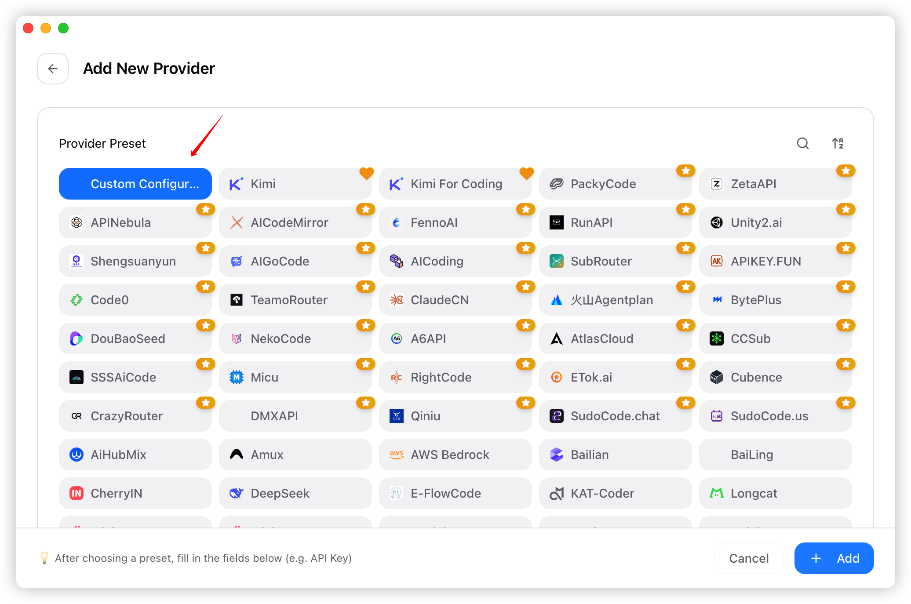
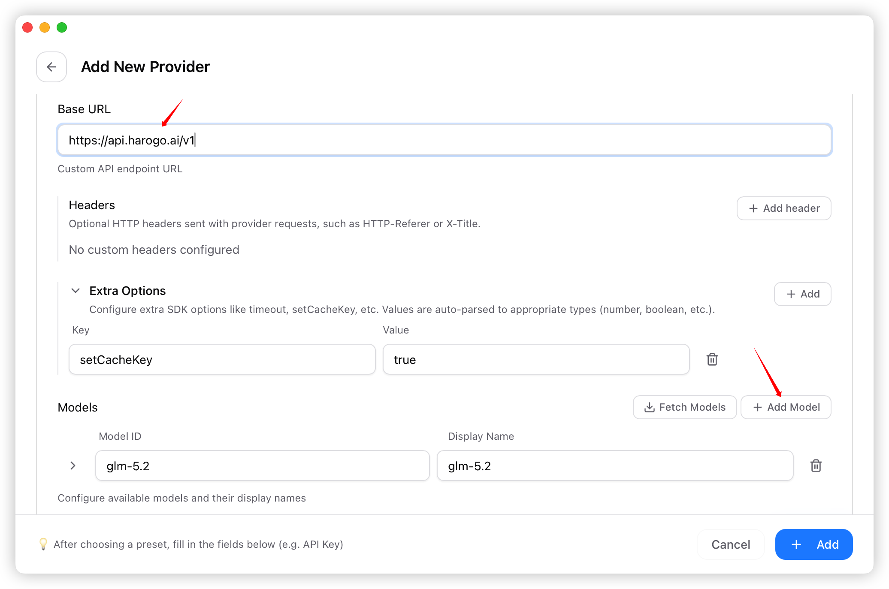

Kuruluma başlamadan önce sisteminizin aşağıdaki gereksinimleri karşıladığından emin olun:

- **Node.js ≥ 18.0.0**
- Platformunuza uygun bir paket yöneticisi (isteğe bağlı):
  - macOS / Linux: `brew`
  - Arch Linux: `paru`
  - Windows: `choco`, `winget` veya `scoop`

## 1. OpenCode'u Kurun

Sisteminize ve araçlarınıza uygun kurulum yöntemini seçin.

### 1. Node.js ile Kurulum

```text
# curl betiğiyle hızlı kurulum
curl -fsSL https://opencode.ai/install | bash

# NPM ile
npm install -g opencode-ai

# Bun ile
bun install -g opencode-ai

# PNPM ile
pnpm install -g opencode-ai

# Yarn ile
yarn global add opencode-ai
```

---

### 2. Homebrew ile (macOS / Linux)

```text
brew install sst/tap/opencode
```

---

### 3. Paru ile (Arch Linux)

```text
paru -S opencode-bin
```

---

### 4. Windows Kurulumu

Windows kullanıcıları OpenCode'u aşağıdakilerden herhangi biriyle kurabilir:

```text
# Chocolatey
choco install opencode

# WinGet
winget install opencode

# Scoop
scoop bucket add extras
scoop install extras/opencode

# Veya NPM ile (Node.js gerektirir) — not: yönetici yetkisi gerektirir
npm install -g opencode-ai
```

---

## 2. OpenCode'u CC Switch ile Yapılandırın

1. CC Switch'i açın, soldan OpenCode'u seçin ve ardından "Sağlayıcı Ekle" (Add Provider) seçeneğine tıklayın.

<Frame>
  
</Frame>

2. Hazır ayarlar listesinden sağlayıcı olarak "Özel Yapılandırma" (Custom Configuration) seçeneğini seçin.

<Frame>
  
</Frame>

3. Sağlayıcı anahtarı, ad, API anahtarı ve uç nokta (`https://api.harogo.ai/v1`) gibi bilgileri doldurun.

<Frame>
  
  
</Frame>

4. Model bilgilerini doldurun ve kaydedin.

<Frame>
  
  
</Frame>

5. Ana ekrana döndüğünüzde sağlayıcı listesinden "harogo"yu seçin ve "Kullan" (Use) seçeneğine tıklayın.

<Frame>
  
</Frame>

---

## 3. Modeli Kullanma

### 1. Kurulumu Doğrulayın

OpenCode'un doğru şekilde kurulup yapılandırıldığını aşağıdaki komutla doğrulayabilirsiniz:

```text
opencode
```


### 2. Bir Model Seçin

`/models` yazın, `harogo` için arama yapın ve istediğiniz modeli seçin.


