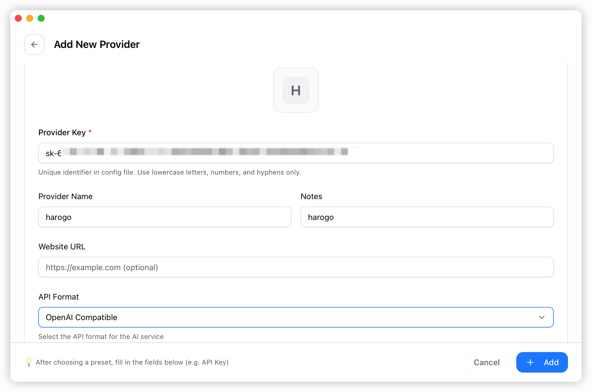

Before you install, make sure your system meets the following requirements:

- **Node.js ≥ 18.0.0**
- A package manager for your platform (optional):
  - macOS / Linux: `brew`
  - Arch Linux: `paru`
  - Windows: `choco`, `winget`, or `scoop`

## 1. Install OpenCode

Pick whichever installation method fits your system and tooling.

### 1. Install via Node.js

```text
# Quick install via curl script
curl -fsSL https://opencode.ai/install | bash

# Using NPM
npm install -g opencode-ai

# Using Bun
bun install -g opencode-ai

# Using PNPM
pnpm install -g opencode-ai

# Using Yarn
yarn global add opencode-ai
```

---

### 2. Using Homebrew (macOS / Linux)

```text
brew install sst/tap/opencode
```

---

### 3. Using Paru (Arch Linux)

```text
paru -S opencode-bin
```

---

### 4. Windows Installation

Windows users can install OpenCode with any of the following:

```text
# Chocolatey
choco install opencode

# WinGet
winget install opencode

# Scoop
scoop bucket add extras
scoop install extras/opencode

# Or via NPM (requires Node.js) — note: requires administrator privileges
npm install -g opencode-ai
```

---

## 2. Configure OpenCode via CC Switch

1. Launch CC Switch, select OpenCode on the left, then click "Add Provider."

<Frame>
  
</Frame>

2. From the preset list, choose "Custom Configuration" as the provider.

<Frame>
  
</Frame>

3. Fill in the provider key, name, API key, and endpoint ("https://api.harogo.ai/v1"), etc.

<Frame>
  
  
</Frame>

4. Fill in the model information, then save.

<Frame>
  
  
</Frame>

5. Back on the home screen, select "harogo" from the provider list and click "Use."

<Frame>
  
</Frame>

---

## 3. Using the Model

### 1. Verify the Installation

You can verify that OpenCode installed and configured correctly with the following command:

```text
opencode
```


### 2. Select a Model

Type `/models`, search for `harogo`, and pick the model you want.


