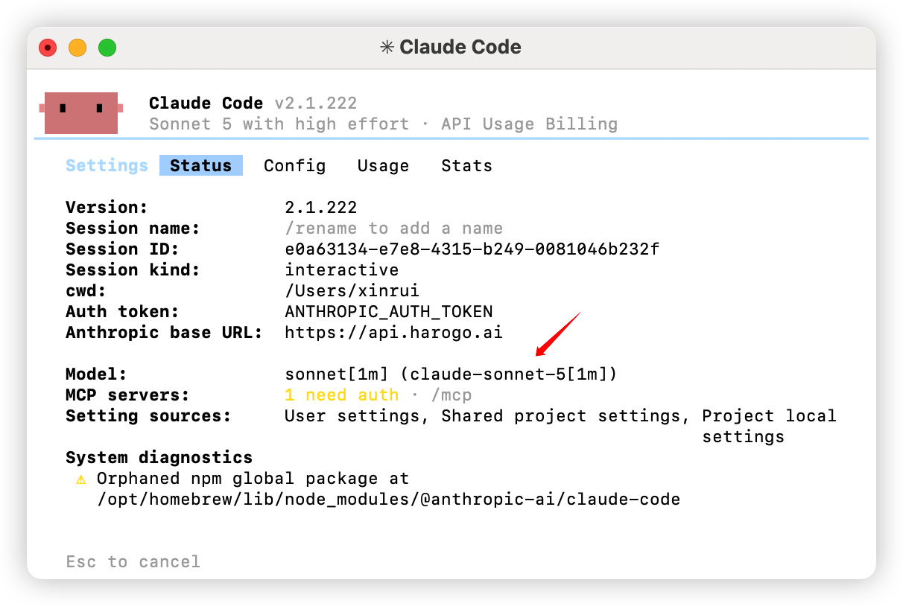

<Note>
**Hướng dẫn này chỉ dùng mô hình Claude.** Claude Code có thể chạy các mô hình Claude (Claude Opus 5.5, Claude Sonnet 5.5, Claude Haiku 5.5) cùng các mô hình không bị giới hạn ứng dụng (GLM, Qwen, Kimi, MiniMax, DeepSeek). Mô hình GPT không dùng được trong Claude Code — xem [Codex](/vi/codex).
</Note>

### 1. Cài đặt Claude Code

#### Cài đặt cục bộ

<CodeGroup>

```shellscript macOS
curl -fsSL https://claude.ai/install.sh | bash
```

```shellscript Windows
irm https://claude.ai/install.ps1 | iex
```

</CodeGroup>

#### Cài đặt qua npm

Yêu cầu [Node.js 18 trở lên](https://nodejs.org/en/download/)

```shellscript
npm install -g @anthropic-ai/claude-code
```

### 2. Cấu hình Harogo API

Để kết nối với dịch vụ mô hình của Harogo qua API tương thích Anthropic, hãy đặt các biến môi trường sau.

1. Đặt `ANTHROPIC_BASE_URL` là `https://api.harogo.ai/`
2. Đặt `ANTHROPIC_AUTH_TOKEN` là API key bạn lấy từ [nền tảng Harogo](https://console.harogo.ai/keys)
3. Đặt `ANTHROPIC_MODEL` là một mô hình Claude được Harogo hỗ trợ, ví dụ `claude-sonnet-5-5`.

<Tabs>
  <Tab title="macOS">
    1. Chạy lệnh sau trong terminal để kiểm tra shell mặc định.

    ```shellscript
    echo $SHELL
    ```

    2. Đặt biến môi trường tùy theo loại shell của bạn:

    <CodeGroup>

    ```shellscript Zsh
    # Thay <HAROGO_API_KEY> bằng key thật lấy từ nền tảng Harogo của bạn
    echo 'export ANTHROPIC_BASE_URL="https://api.harogo.ai"' >> ~/.zshrc
    echo 'export ANTHROPIC_AUTH_TOKEN="<HAROGO_API_KEY>"' >> ~/.zshrc
    echo 'export ANTHROPIC_MODEL="claude-sonnet-5-5"' >> ~/.zshrc
    ```

    ```shellscript Bash
    # Thay <HAROGO_API_KEY> bằng key thật lấy từ nền tảng Harogo của bạn
    echo 'export ANTHROPIC_BASE_URL="https://api.harogo.ai"' >> ~/.bash_profile
    echo 'export ANTHROPIC_AUTH_TOKEN="<HAROGO_API_KEY>"' >> ~/.bash_profile
    echo 'export ANTHROPIC_MODEL="claude-sonnet-5-5"' >> ~/.bash_profile
    ```

    </CodeGroup>

    3. Chạy lệnh sau trong terminal để áp dụng biến môi trường.

    <CodeGroup>

    ```shellscript Zsh
    source ~/.zshrc
    ```

    ```shellscript Bash
    source ~/.bash_profile
    ```

    </CodeGroup>

    4. Mở một terminal mới và chạy các lệnh sau để xác nhận biến môi trường đã có hiệu lực.

    ```shellscript
    echo $ANTHROPIC_BASE_URL
    test -n "$ANTHROPIC_AUTH_TOKEN" && echo "ANTHROPIC_AUTH_TOKEN is set"
    echo $ANTHROPIC_MODEL
    ```
  </Tab>
  <Tab title="Windows">
    Trên Windows, bạn có thể đặt base URL và [API key](https://console.harogo.ai/keys) của Harogo làm biến môi trường bằng CMD hoặc PowerShell.

    <Tabs>
      <Tab title="CMD">
        1. Chạy lệnh sau trong CMD để đặt biến môi trường.

        ```shellscript
        REM Thay <HAROGO_API_KEY> bằng key thật lấy từ nền tảng Harogo của bạn
        setx ANTHROPIC_AUTH_TOKEN "<HAROGO_API_KEY>"
        setx ANTHROPIC_BASE_URL "https://api.harogo.ai"
        setx ANTHROPIC_MODEL "claude-sonnet-5-5"
        ```

        2. Mở một cửa sổ CMD mới và chạy các lệnh sau để xác nhận biến môi trường đã có hiệu lực.

        ```shellscript
        if defined ANTHROPIC_AUTH_TOKEN echo ANTHROPIC_AUTH_TOKEN is set
        echo %ANTHROPIC_BASE_URL%
        echo %ANTHROPIC_MODEL%
        ```
      </Tab>
      <Tab title="PowerShell">
        1. Chạy lệnh sau trong PowerShell để đặt biến môi trường.

        ```shellscript
        # Thay <HAROGO_API_KEY> bằng key thật lấy từ nền tảng Harogo của bạn
        [Environment]::SetEnvironmentVariable("ANTHROPIC_AUTH_TOKEN", "<HAROGO_API_KEY>", [EnvironmentVariableTarget]::User)
        [Environment]::SetEnvironmentVariable("ANTHROPIC_BASE_URL", "https://api.harogo.ai", [EnvironmentVariableTarget]::User)
        [Environment]::SetEnvironmentVariable("ANTHROPIC_MODEL", "claude-sonnet-5-5", [EnvironmentVariableTarget]::User)
        ```

        2. Mở một cửa sổ PowerShell mới và chạy các lệnh sau để xác nhận biến môi trường đã có hiệu lực.

        ```shellscript
        if ($env:ANTHROPIC_AUTH_TOKEN) { "ANTHROPIC_AUTH_TOKEN is set" }
        echo $env:ANTHROPIC_BASE_URL
        echo $env:ANTHROPIC_MODEL
        ```
      </Tab>
    </Tabs>
  </Tab>
</Tabs>

<Note>
  Nếu bạn định quản lý Claude Code qua CC Switch, không nên đặt thêm các giá trị toàn cục `ANTHROPIC_AUTH_TOKEN`, `ANTHROPIC_BASE_URL` hoặc `ANTHROPIC_MODEL`. Biến môi trường ở cấp hệ thống hoặc cấp người dùng có thể ghi đè cấu hình nhà cung cấp do CC Switch ghi ra, khiến giao diện vẫn hiển thị đúng nhà cung cấp đang chọn trong khi Claude Code thực tế vẫn chạy bằng key hoặc mô hình cũ.
</Note>

### 3. Kiểm tra cấu hình

Sau khi thiết lập biến môi trường hoặc CC Switch, hãy gửi trước một yêu cầu tối giản để xác nhận key, mô hình và endpoint tương thích Anthropic đều hoạt động, rồi mới bắt đầu một phiên làm việc dài.

<CodeGroup>

```bash macOS/Linux
curl https://api.harogo.ai/v1/messages \
  -H "content-type: application/json" \
  -H "anthropic-version: 2023-06-01" \
  -H "x-api-key: $ANTHROPIC_AUTH_TOKEN" \
  -d '{
    "model": "claude-sonnet-5-5",
    "max_tokens": 16,
    "messages": [{"role": "user", "content": "1+1, output only the answer"}]
  }'
```

```powershell Windows
curl.exe https://api.harogo.ai/v1/messages `
  -H "content-type: application/json" `
  -H "anthropic-version: 2023-06-01" `
  -H "x-api-key: $env:ANTHROPIC_AUTH_TOKEN" `
  -d "{\"model\":\"claude-sonnet-5-5\",\"max_tokens\":16,\"messages\":[{\"role\":\"user\",\"content\":\"1+1, output only the answer\"}]}"
```

</CodeGroup>

### 4. Bắt đầu dùng Claude Code

Sau khi cấu hình xong, hãy chuyển đến thư mục làm việc và chạy lệnh `claude` trong terminal để bắt đầu.

```bash
$ cd /path/your-project
> claude
```

Nếu khi khởi động bạn thấy `Not logged in · Please run /login`, hoặc bị chuyển vào luồng đăng nhập của Anthropic, thường là do Claude Code chưa nhận được cấu hình Harogo hợp lệ, hoặc chưa hoàn tất bước hướng dẫn ban đầu (onboarding). Trước tiên, hãy xác nhận yêu cầu tối giản ở bước trước trả về `2`, và kiểm tra xem `ANTHROPIC_AUTH_TOKEN`, `ANTHROPIC_BASE_URL` hoặc `ANTHROPIC_MODEL` có đang bị các biến môi trường toàn cục cũ ghi đè hay không. Sau khi đã xác nhận key hoạt động, nếu vẫn bị chuyển đến luồng đăng nhập, bạn có thể bỏ qua bước hướng dẫn ban đầu theo các bước dưới đây:


1. Tìm tệp `.claude.json` trong thư mục home của bạn:
   - macOS / Linux: `~/.claude.json`
   - Windows: `C:\Users\%USERNAME%\.claude.json`
2. Đặt trường `hasCompletedOnboarding` thành `true`

```json
{
  "hasCompletedOnboarding": true
}
```

3. Lưu tệp, rồi chạy lại `claude` trong terminal.

#### (Tùy chọn) Các cách cấu hình mô hình khác

Claude Code hỗ trợ các cách cấu hình mô hình sau, **xếp theo mức ưu tiên từ cao xuống thấp** — thiết lập có mức ưu tiên cao hơn sẽ ghi đè thiết lập có mức ưu tiên thấp hơn.

1. **Trong cuộc hội thoại:** chạy lệnh `/model <model-name>` để chuyển mô hình. Phù hợp khi cần chuyển nhanh một lần.

```text
/model claude-sonnet-5-5
```

2. **Khi khởi động Claude Code:** chạy `claude --model <model-name>` để chỉ định mô hình. Phù hợp cho một phiên làm việc.

```text
claude --model claude-sonnet-5-5
```

3. **Đặt biến môi trường:** cấu hình các cấp mô hình khác nhau theo độ phức tạp của tác vụ, Claude Code sẽ tự chọn mô hình phù hợp cho từng tác vụ. Áp dụng toàn cục.

```shellscript
export ANTHROPIC_DEFAULT_OPUS_MODEL="claude-opus-5-5"
export ANTHROPIC_DEFAULT_SONNET_MODEL="claude-sonnet-5-5"
export ANTHROPIC_DEFAULT_HAIKU_MODEL="claude-haiku-5-5"
```

Trong đó:

- `ANTHROPIC_DEFAULT_OPUS_MODEL`: dùng cho suy luận phức tạp, thiết kế kiến trúc và các tác vụ khó khác.
- `ANTHROPIC_DEFAULT_SONNET_MODEL`: dùng cho viết mã, triển khai tính năng và các tác vụ hằng ngày khác.
- `ANTHROPIC_DEFAULT_HAIKU_MODEL`: dùng cho kiểm tra cú pháp, tìm kiếm tệp và các tác vụ đơn giản khác.

4. **Đặt cố định trong settings.json:** ghi cấu hình mô hình vào tệp cấu hình người dùng của Claude Code (ví dụ `~/.claude/settings.json`, hoặc `C:\Users\%USERNAME%\.claude\settings.json` trên Windows) hoặc vào tệp cấu hình cấp dự án, để thiết lập cố định ở cấp người dùng hoặc cấp dự án.

## Cấu hình qua CC Switch

1. Mở CC Switch, chọn **Claude Code** ở bên trái, rồi nhấp "Thêm nhà cung cấp" (Add Provider).


2. Trong danh sách cài đặt sẵn, chọn nhà cung cấp "Cấu hình tùy chỉnh" (Custom Configuration).


3. Điền tên nhà cung cấp, API key, endpoint ([https://api.harogo.ai](https://api.harogo.ai)) và các thông tin khác. Điền xong, nhấp "Thêm" (Add).


4. Quay lại màn hình chính, chọn "harogo" trong danh sách nhà cung cấp và nhấp "Sử dụng" (Use).


<Frame>
  
  
</Frame>

<Frame>
  
</Frame>

Mẹo: khi Claude Code đã mở trong terminal, gõ <kbd>/status</kbd> để kiểm tra ID mô hình, hoặc <kbd>/models</kbd> để chọn một mô hình khác đã cấu hình.

<Warning>
  Nếu CC Switch hiển thị "Phát hiện xung đột biến môi trường hệ thống" (System environment variable conflict detected), hãy xử lý `ANTHROPIC_AUTH_TOKEN`, `ANTHROPIC_BASE_URL` và `ANTHROPIC_MODEL` trước. Các biến toàn cục này ghi đè cấu hình nhà cung cấp hiện tại — một giá trị giữ chỗ như `ANTHROPIC_AUTH_TOKEN=<HAROGO_API_KEY>` sẽ khiến xác thực thất bại ngay. Khi chắc chắn không còn cần các biến toàn cục đó, hãy xóa các mục xung đột trong CC Switch, hoặc tự xóa biến môi trường cấp hệ thống/người dùng rồi khởi động lại terminal.
</Warning>
