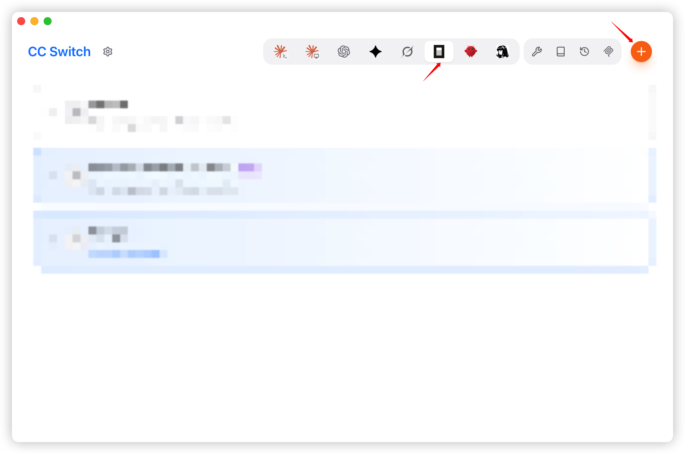

Trước khi cài đặt, hãy đảm bảo hệ thống của bạn đáp ứng các yêu cầu sau:

- **Node.js ≥ 18.0.0**
- Trình quản lý gói cho nền tảng của bạn (tùy chọn):
  - macOS / Linux: `brew`
  - Arch Linux: `paru`
  - Windows: `choco`, `winget` hoặc `scoop`

## 1. Cài đặt OpenCode

Chọn cách cài đặt phù hợp với hệ thống và công cụ bạn đang dùng.

### 1. Cài đặt qua Node.js

```text
# Cài đặt nhanh bằng script curl
curl -fsSL https://opencode.ai/install | bash

# Dùng NPM
npm install -g opencode-ai

# Dùng Bun
bun install -g opencode-ai

# Dùng PNPM
pnpm install -g opencode-ai

# Dùng Yarn
yarn global add opencode-ai
```

---

### 2. Dùng Homebrew (macOS / Linux)

```text
brew install sst/tap/opencode
```

---

### 3. Dùng Paru (Arch Linux)

```text
paru -S opencode-bin
```

---

### 4. Cài đặt trên Windows

Người dùng Windows có thể cài đặt OpenCode bằng một trong các cách sau:

```text
# Chocolatey
choco install opencode

# WinGet
winget install opencode

# Scoop
scoop bucket add extras
scoop install extras/opencode

# Hoặc qua NPM (cần Node.js) — lưu ý: cần quyền quản trị viên
npm install -g opencode-ai
```

---

## 2. Cấu hình OpenCode qua CC Switch

1. Mở CC Switch, chọn OpenCode ở bên trái, rồi nhấp "Thêm nhà cung cấp" (Add Provider).

<Frame>
  
</Frame>

2. Trong danh sách cài đặt sẵn, chọn nhà cung cấp "Cấu hình tùy chỉnh" (Custom Configuration).

<Frame>
  
</Frame>

3. Điền key nhà cung cấp, tên, API key, endpoint ("https://api.harogo.ai/v1") và các thông tin khác.

<Frame>
  
  
</Frame>

4. Điền thông tin mô hình, rồi lưu lại.

<Frame>
  
  
</Frame>

5. Quay lại màn hình chính, chọn "harogo" trong danh sách nhà cung cấp và nhấp "Sử dụng" (Use).

<Frame>
  
</Frame>

---

## 3. Sử dụng mô hình

### 1. Kiểm tra cài đặt

Bạn có thể kiểm tra OpenCode đã được cài đặt và cấu hình đúng hay chưa bằng lệnh sau:

```text
opencode
```


### 2. Chọn mô hình

Gõ `/models`, tìm `harogo` và chọn mô hình bạn muốn dùng.


